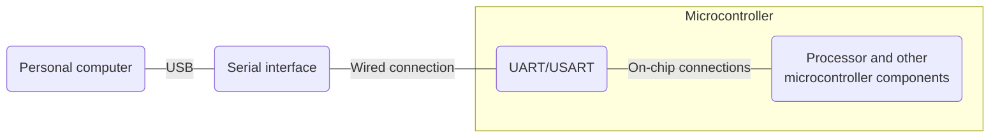
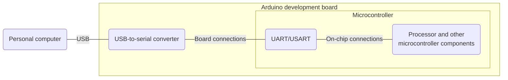

# Using serial communication

A serial connection enables two-way character-based communication between a microcontroller and a personal computer, as shown below.


### Electrical hardware

Serial communication connects two serial interfaces, so both the computer and the microcontroller must support it. A computer may require an external serial adapter, usually connected through USB. Most microcontrollers include a UART or USART peripheral. The following diagram shows the connection in more detail.



RS-232 is a standard for serial communication; its basic principles are covered in the course material.

#### Serial connection with Arduino

On Arduino boards with a built-in USB-to-serial converter, connecting to a computer is simplified. The connection is shown below.



### Software

On the computer, terminal software provides a console for sending and receiving messages. The Arduino IDE includes a Serial Monitor. On the microcontroller, a program must configure and use the serial peripheral. The Arduino [Serial](https://www.arduino.cc/reference/en/language/functions/communication/serial/) library provides a convenient interface for this.

#### Writing strings

The program establishes serial communication with the computer and prints the counter value at one-second intervals.

```c
//Global variables
//Counter variable
int counter = 0;

//Setup function
void setup() {
  //Initialize serial communication and set the baud rate
  Serial.begin(9600);
}

//Main loop
void loop() {
  //Send a label over the serial connection
  Serial.print("Counter: ");
  //Send the counter value
  Serial.println(counter);
  //Wait for 1 second
  delay(1000);
}
```

The first output uses _Serial.print()_ to send the requested string. The second uses _Serial.println()_, which also appends a line ending so that successive values appear on separate console lines. Sending a newline character with _Serial.print()_ can also move the output to the next line.

#### Reading characters

The program reads incoming characters. Character "1" turns the built-in LED on, and character "0" turns it off.

```c
//Setup function
void setup() {
  //Initialize serial communication and set the baud rate
  Serial.begin(9600);
}
//Main loop
void loop() {
  //Check whether any characters have arrived in the serial buffer
  if (Serial.available() > 0) {
    //Read the value received over the serial connection
    int character = Serial.read();
    //Check for ASCII code 49, the character '1'
    if (character == '1') {
      digitalWrite(LED_BUILTIN, HIGH);
    }
    //Check for ASCII code 48, the character '0'
    if (character == 48) {
      digitalWrite(LED_BUILTIN, LOW);
    }
  }
}
```

_Serial.available()_ checks whether data has arrived before the program attempts to read it. The example only processes a character when the receive buffer contains data.

#### Reading and writing strings

The program reads an incoming string. The command "on" turns the built-in LED on and prints "LED on"; "off" turns it off and prints "LED off".

```c
//Setup function
void setup() {
  //Initialize serial communication and set the baud rate
  Serial.begin(9600);
}
//Main loop
void loop() {
  //Check whether any characters have arrived in the serial buffer
  if (Serial.available() > 0) {
    //Read the string received over the serial connection
    String message = Serial.readString();
    //Remove the final newline character from the string
    message = message.substring(0, message.length() - 1);

    //Check whether the received string is 'on'
    if ( message == "on") {
      digitalWrite(LED_BUILTIN, HIGH);
      Serial.println("LED on");
    }
    //Check whether the received string is 'off'
    if (message == "off") {
      digitalWrite(LED_BUILTIN, LOW);
      Serial.println("LED off");
    }
  }
}
```


**NOTE:** Serial communication takes processing time and can slow down the microcontroller's other tasks.

