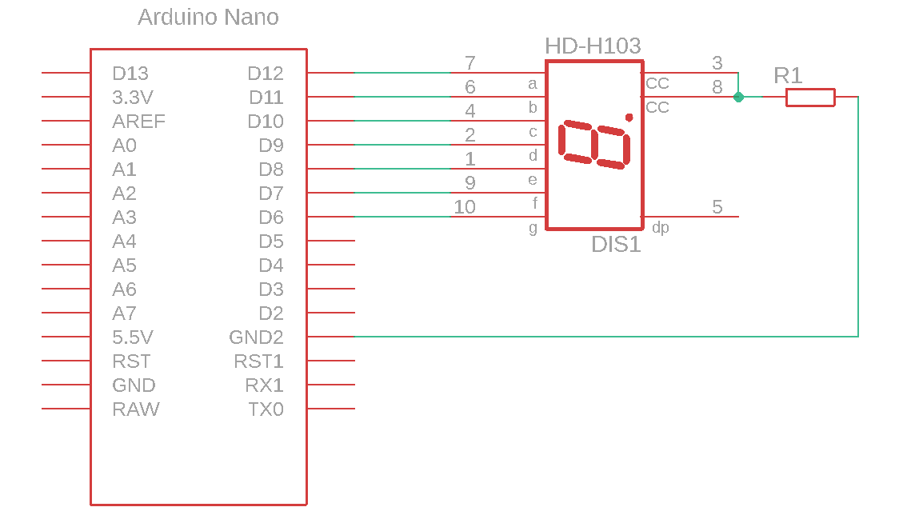
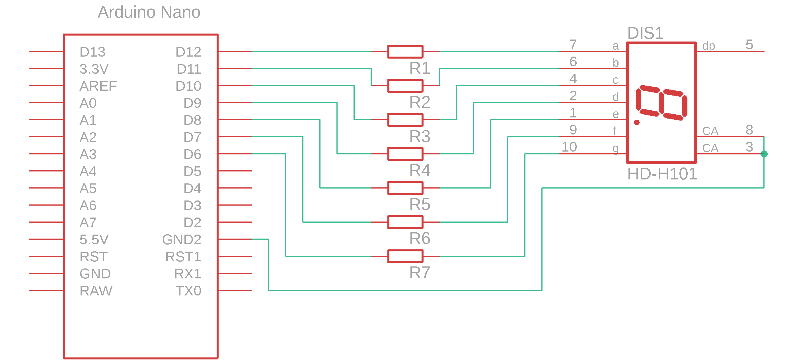

# 7-segment LED display and microcontroller

A 7-segment display is used to display decimal digits.

### Circuit diagram

Connect the display as shown in the diagram.

<figure><figcaption>
Display connected using a single resistor R1
</figcaption></figure>


**CAUTION:** The connection shown above is not optimal. As the number of illuminated LEDs changes, the current through resistor $$R_{1}$$ changes. This changes the voltage drop across the resistor and the LEDs, resulting in different brightness levels. The more LEDs are on, the dimmer they become, which is undesirable.


<figure><figcaption>
7-segment display connected using one resistor per segment
</figcaption></figure>

### Electrical components

| Component | Part number | Manufacturer | Datasheet |
| --------------- | ------------ | ------------ | ------------------------------------------------------------------------------------------------------------------------------------------------------------------------------------------------------------------------------- |
| display | SC52-11HWA   | Kingbright   | [datasheet](https://files.gitbook.com/v0/b/gitbook-x-prod.appspot.com/o/spaces%2FOjZ1XG64rvc2AeRBUH5H%2Fuploads%2FiTDJNQEXWQcxz4gnSSSU%2FKingbright-SC52-11HWA.pdf?alt=media\&token=5a0e4220-5252-404e-8171-041c73c52f6c) |
| microcontroller | ATmega328    | Microchip    | [datasheet](https://files.gitbook.com/v0/b/gitbook-x-prod.appspot.com/o/spaces%2FOjZ1XG64rvc2AeRBUH5H%2Fuploads%2FVdyx5L6r6wqAilPGHpen%2FATmega.pdf?alt=media\&token=a7f48452-034e-4411-b859-d87bf77d7454) |
| development board | Arduino Nano | Gravitech    | [datasheet](https://files.gitbook.com/v0/b/gitbook-x-prod.appspot.com/o/spaces%2FOjZ1XG64rvc2AeRBUH5H%2Fuploads%2FmBK4u5xIBnLKRFzfea5q%2FGravitech\_Arduino\_Nano3\_0.pdf?alt=media\&token=b8cb7c7d-aee0-4845-863b-88c382cca882) |
| resistors | /            | Multicomp    | [datasheet](https://files.gitbook.com/v0/b/gitbook-x-prod.appspot.com/o/spaces%2FOjZ1XG64rvc2AeRBUH5H%2Fuploads%2FwniMD8SuO6uL0i9SD8N2%2Fupor.pdf?alt=media\&token=3553e1a0-af07-4fd2-8af3-615a8cee41e7) |

### Component sizing

To calculate the current-limiting resistors for the display LEDs, refer to [LED and microcontroller](led-in-mikrokrmilnik.md).
