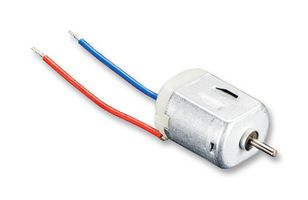
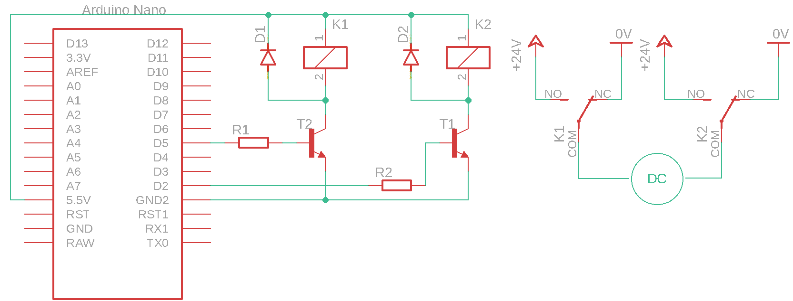
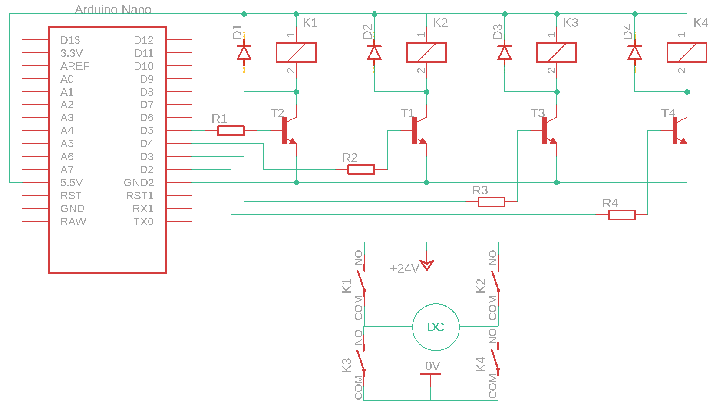

# DC motor and microcontroller

A DC motor is one of the most common actuators. Applications include driving mixers, conveyor belts, valves and pumps. The figure shows an example of a DC motor.

<figure><figcaption>
DC motor
</figcaption></figure>

A DC motor has two electrical terminals. Connecting a voltage source to these terminals makes the motor run. The direction of rotation depends on the direction of the current.

There are several ways to control a motor. The following sections present three methods using the same types of electrical components and component-sizing approach.

## Electrical components

| Component | Part number | Manufacturer | Datasheet |
| --------------- | ------------ | ---------------- | ------------------------------------------------------------------------------------------------------------------------------------------------------------------------------------------------------------------------------- |
| motor | 37488        | FischerTechnik   | [datasheet](https://files.gitbook.com/v0/b/gitbook-x-prod.appspot.com/o/spaces%2FOjZ1XG64rvc2AeRBUH5H%2Fuploads%2FGLSsD9tC9dNNH42jTjeJ%2Fftspares.pdf?alt=media\&token=2e875bd6-322a-431e-bf60-9f0cf77b16e4) |
| relay | V23105       | AXICOM           | [datasheet](https://files.gitbook.com/v0/b/gitbook-x-prod.appspot.com/o/spaces%2FOjZ1XG64rvc2AeRBUH5H%2Fuploads%2FNozBDqjgGq8wwq5ogwFr%2FreleyV23105.pdf?alt=media\&token=6e9614c8-4e16-4238-b2bd-0e36a72d839d) |
| transistor | BC550        | ON Semiconductor | [datasheet](https://files.gitbook.com/v0/b/gitbook-x-prod.appspot.com/o/spaces%2FOjZ1XG64rvc2AeRBUH5H%2Fuploads%2FNkIToA5TJdzhLiJa8uWY%2FtranBC550.pdf?alt=media\&token=64e3614f-356d-40e2-867e-8471feb14908) |
| diode | 1N4007       | FairChild        | [datasheet](https://files.gitbook.com/v0/b/gitbook-x-prod.appspot.com/o/spaces%2FOjZ1XG64rvc2AeRBUH5H%2Fuploads%2FVo1DGisQWbUp2fduCfXv%2F1N4007-471020.pdf?alt=media\&token=9852369f-aa20-4b5d-80e7-1aeb8fe76d6a) |
| microcontroller | ATmega328    | Microchip        | [datasheet](https://files.gitbook.com/v0/b/gitbook-x-prod.appspot.com/o/spaces%2FOjZ1XG64rvc2AeRBUH5H%2Fuploads%2FVdyx5L6r6wqAilPGHpen%2FATmega.pdf?alt=media\&token=a7f48452-034e-4411-b859-d87bf77d7454) |
| development board | Arduino Nano | Gravitech        | [datasheet](https://files.gitbook.com/v0/b/gitbook-x-prod.appspot.com/o/spaces%2FOjZ1XG64rvc2AeRBUH5H%2Fuploads%2FmBK4u5xIBnLKRFzfea5q%2FGravitech\_Arduino\_Nano3\_0.pdf?alt=media\&token=b8cb7c7d-aee0-4845-863b-88c382cca882) |
| resistor | /            | Multicomp        | [datasheet](https://files.gitbook.com/v0/b/gitbook-x-prod.appspot.com/o/spaces%2FOjZ1XG64rvc2AeRBUH5H%2Fuploads%2FwniMD8SuO6uL0i9SD8N2%2Fupor.pdf?alt=media\&token=3553e1a0-af07-4fd2-8af3-615a8cee41e7) |

## Component sizing

For the procedure for selecting the relay, transistor and resistors, refer to [Relay and microcontroller](rele-in-mikrokrmilnik.md).

The relay contact's specified maximum continuous current must exceed the motor current. In this example, the motor operating current is $$1A$$ and the relay contact's permitted continuous current is $$3A$$, so the contact meets this operating-current requirement.

## On/off motor control

On/off control treats the motor as a digital load with two states: stopped and running. The diagram shows the motor connected to the microcontroller through a relay.

<figure><figcaption>
Circuit diagram for on/off motor control
</figcaption></figure>

For the circuit description and operation, refer to [Relay and microcontroller](rele-in-mikrokrmilnik.md). The relay contact is connected in series with the DC motor. Energizing the relay closes contact **K1**, allowing current to flow through the motor and making it run.

## Bidirectional motor control

The diagram shows the motor connected to the microcontroller through relays.

<figure><figcaption>
Circuit diagram for bidirectional motor control
</figcaption></figure>

If the relays have changeover contacts with both normally open and normally closed connections available, only two microcontroller digital outputs are needed. The table describes the motor states.

| K1 | K2 | Motor |
| -- | -- | ----- |
| 0 | 0 | Stopped |
| 0 | 1 | Left |
| 1 | 0 | Right |
| 1 | 1 | Stopped |

## Bidirectional motor control using an H-bridge

The diagram shows the motor connected to the microcontroller through relays arranged as an H-bridge.

<figure><figcaption>
Circuit diagram for motor control using an H-bridge
</figcaption></figure>

If only normally open relay contacts are available, four microcontroller digital outputs are needed. The outputs must be controlled correctly: energizing both relays in the same bridge leg at once can cause a short circuit. The table describes the motor states.

| K1 | K2 | K3 | K4 | Motor |
| -- | -- | -- | -- | ----- |
| 0 | 0 | 0 | 0 | Stopped |
| 0 | 1 | 1 | 0 | Right |
| 1 | 0 | 0 | 1 | Left |

Other combinations either leave the motor stopped or cause a short circuit.
