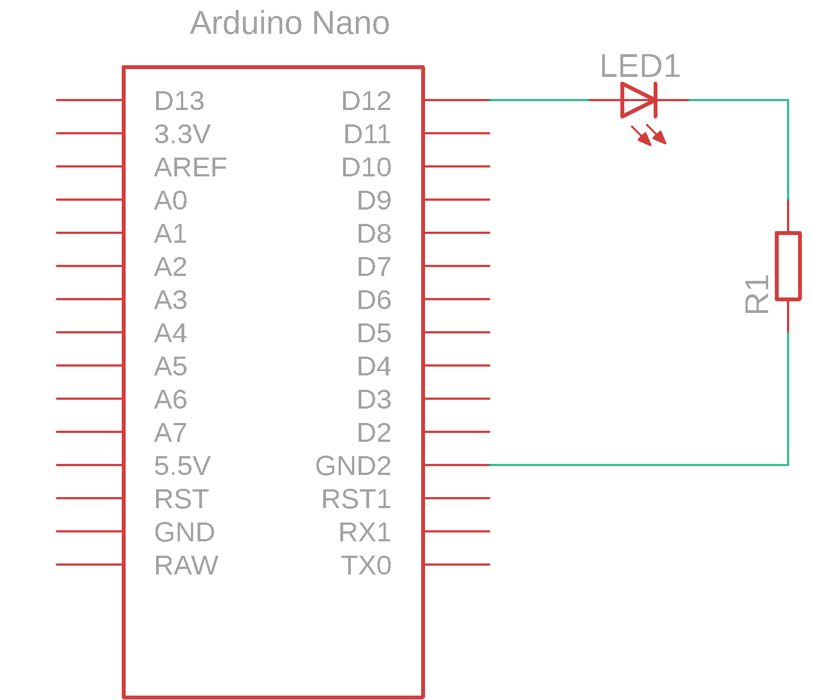
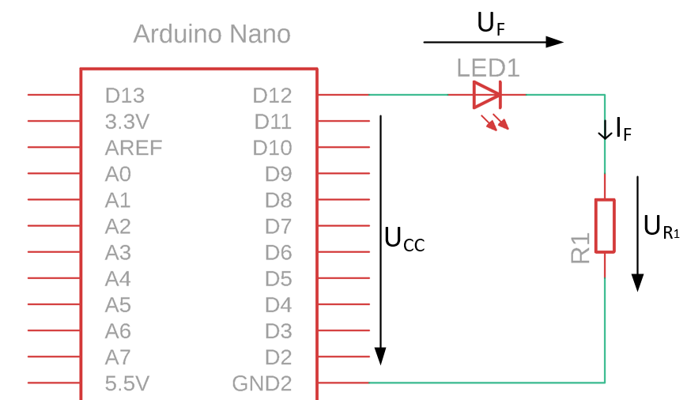
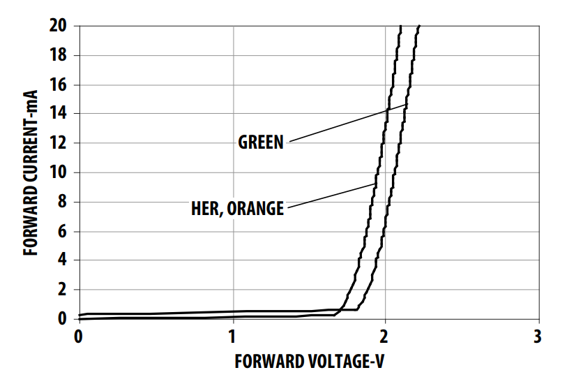

# LED and microcontroller

To transfer information from a microcontroller to an LED, we need to build an electrical circuit. We begin by drawing a circuit diagram.

## Circuit diagram

The diagram shows how to connect the LED to the microcontroller.

<figure><figcaption></figcaption></figure>

**LED1** is connected between pin **D12** and resistor **R1**. The other end of **R1** is connected to the microcontroller ground.

Circuit operation:

* When the program sets the microcontroller output to a logic high level, pin **D12** provides $5V$. Current flows through the LED and resistor, and the LED lights up.


**NOTE:** Components in an electrical circuit need suitable protection. An LED requires a current-limiting resistor.


For correct operation, we must include a resistor and select its value according to the LED specifications.

## Electrical components

| Component | Part number | Manufacturer | Datasheet |
| --------------- | ------------ | ------------ | ------------------------------------------------------------------------------------------------------------------------------------------------------------------------------------------------------------------------------- |
| LED             | HLMP-Y301    | AVAGO        | [datasheet](https://files.gitbook.com/v0/b/gitbook-x-prod.appspot.com/o/spaces%2FOjZ1XG64rvc2AeRBUH5H%2Fuploads%2FPyS4PalUJ0fYJHMjE9ch%2Fled.pdf?alt=media\&token=b35575d1-fe44-409f-8115-6a4a8f0ca843) |
| microcontroller | ATmega328    | Microchip    | [datasheet](https://files.gitbook.com/v0/b/gitbook-x-prod.appspot.com/o/spaces%2FOjZ1XG64rvc2AeRBUH5H%2Fuploads%2FVdyx5L6r6wqAilPGHpen%2FATmega.pdf?alt=media\&token=a7f48452-034e-4411-b859-d87bf77d7454) |
| development board | Arduino Nano | Gravitech    | [datasheet](https://files.gitbook.com/v0/b/gitbook-x-prod.appspot.com/o/spaces%2FOjZ1XG64rvc2AeRBUH5H%2Fuploads%2FmBK4u5xIBnLKRFzfea5q%2FGravitech\_Arduino\_Nano3\_0.pdf?alt=media\&token=b8cb7c7d-aee0-4845-863b-88c382cca882) |
| resistor | /            | Multicomp    | [datasheet](https://files.gitbook.com/v0/b/gitbook-x-prod.appspot.com/o/spaces%2FOjZ1XG64rvc2AeRBUH5H%2Fuploads%2FwniMD8SuO6uL0i9SD8N2%2Fupor.pdf?alt=media\&token=3553e1a0-af07-4fd2-8af3-615a8cee41e7) |

## Component sizing

The following diagram shows the electrical quantities used to calculate the component values.

<figure><figcaption>
Electrical quantities used in the calculations
</figcaption></figure>

### Resistor R1

The LED datasheet specifies a maximum DC forward current of _20 mA_. We decide that the LED is sufficiently bright at half this current, _10 mA_, and design the circuit for that value. At _10 mA_, the forward voltage is approximately _2 V_, as shown by the characteristic curve:

<figure><figcaption>
LED current-voltage characteristic
</figcaption></figure>

Calculate the resistance of R1 using:

$$
R_1 = \frac{U_{R_1}}{I_F}=\frac{U_{CC}-U_F}{I_F}
$$

Substitute the known values:

* $$U_{CC}=5V$$: microcontroller supply voltage
* $$U_F=2V$$: LED forward voltage at the selected current
* $$I_F=10mA$$: selected LED current

$$
R_1 = \frac{5V-2V}{10mA}=300\Omega
$$
