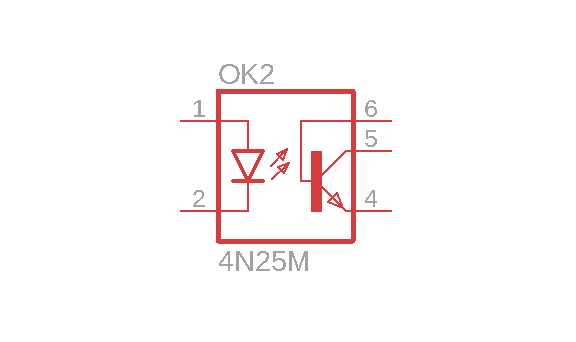
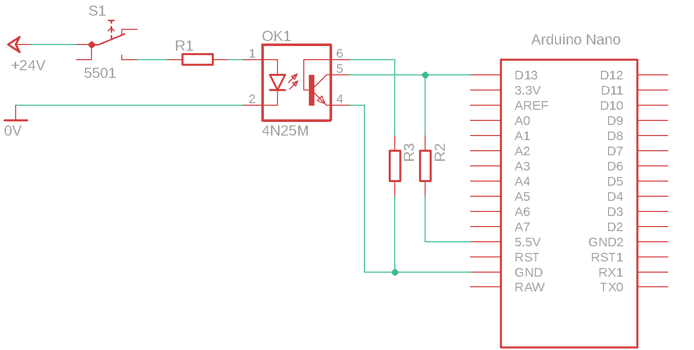

# Optocoupler and microcontroller

Galvanic isolation of a microcontroller's digital inputs is needed when we want to transfer information to the controller while keeping the signal source circuit electrically separate from the microcontroller circuit. It also allows different voltage levels to be interfaced and helps protect the microcontroller against electrical overloads.

The standard industrial voltage level is 24 V. A microcontroller operating at 5 V or 3.3 V therefore requires voltage-level adaptation. An optocoupler is one possible solution.

An optocoupler transfers digital information between two electrical circuits using light. The figure shows its schematic representation.

<figure><figcaption></figcaption></figure>

The optocoupler has an LED on the input side, connected to the signal source circuit, and a phototransistor on the output side, connected to the receiving circuit.

We begin building the circuit by drawing a circuit diagram.

## Circuit diagram

The figure shows how to connect the optocoupler.

<figure><figcaption>
Using an optocoupler to provide galvanic isolation between two supply circuits
</figcaption></figure>

The input LED is connected to the _24 V_ supply through button **S1** and resistor **R1**. The phototransistor is connected to microcontroller input **D12**.


**NOTE:** The connection between the optocoupler output and the microcontroller uses a **pull-up** resistor, resulting in inverted logic.


Circuit operation:

* When the user presses the button, current flows through the optocoupler LED, which emits light.
* The light reaches the phototransistor and turns it on.
* With the transistor on, current flows through resistor **R2** and the microcontroller input is pulled to **GND**, corresponding to logic 0 or _FALSE_.
* With the transistor off, current does not flow through **R2**, and the microcontroller input is high, corresponding to logic 1 or _TRUE_.

## Electrical components

| Component | Part number | Manufacturer | Datasheet |
| --------------- | ------------ | ------------ | ---------------------------------------------------------------------------------------------------------------------------------------------------------------------------------------------------------------------------- |
| optocoupler | 4N25         | Vishay       | [datasheet](https://files.gitbook.com/v0/b/gitbook-x-prod.appspot.com/o/spaces%2FOjZ1XG64rvc2AeRBUH5H%2Fuploads%2FCAMTxKqiihmMlFemcG0r%2F4n25.pdf?alt=media\&token=8988286b-b7b5-46ec-a997-ead3a9f7d1e9) |
| microcontroller | ATmega328    | Microchip    | [datasheet](https://files.gitbook.com/v0/b/gitbook-x-prod.appspot.com/o/spaces%2FOjZ1XG64rvc2AeRBUH5H%2Fuploads%2FVdyx5L6r6wqAilPGHpen%2FATmega.pdf?alt=media\&token=a7f48452-034e-4411-b859-d87bf77d7454) |
| development board | Arduino Nano | Gravitech    | [datasheet](https://files.gitbook.com/v0/b/gitbook-x-prod.appspot.com/o/spaces%2FOjZ1XG64rvc2AeRBUH5H%2Fuploads%2FmBK4u5xIBnLKRFzfea5q%2FGravitech_Arduino_Nano3_0.pdf?alt=media\&token=b8cb7c7d-aee0-4845-863b-88c382cca882) |
| resistors | /            | Multicomp    | [datasheet](https://files.gitbook.com/v0/b/gitbook-x-prod.appspot.com/o/spaces%2FOjZ1XG64rvc2AeRBUH5H%2Fuploads%2FwniMD8SuO6uL0i9SD8N2%2Fupor.pdf?alt=media\&token=3553e1a0-af07-4fd2-8af3-615a8cee41e7) |

## Component sizing

### Resistor R1

For the calculation of R1, refer to [LED and microcontroller](led-in-mikrokrmilnik.md).

### Resistor R2

For the calculation of R2, refer to [Button and microcontroller](tipka-in-mikrokrmilnik.md).

### Resistor R3

The **4N25** optocoupler exposes the phototransistor base on pin _6_. This connection provides an additional way to control the transistor. We will not use that option here, so we connect the base to the negative supply potential through resistor R3. An unconnected lead can act as an antenna, picking up electromagnetic interference and causing unintended transistor conduction. For guidance on selecting R3, refer to [Component sizing](tipka-in-mikrokrmilnik.md#component-sizing).
