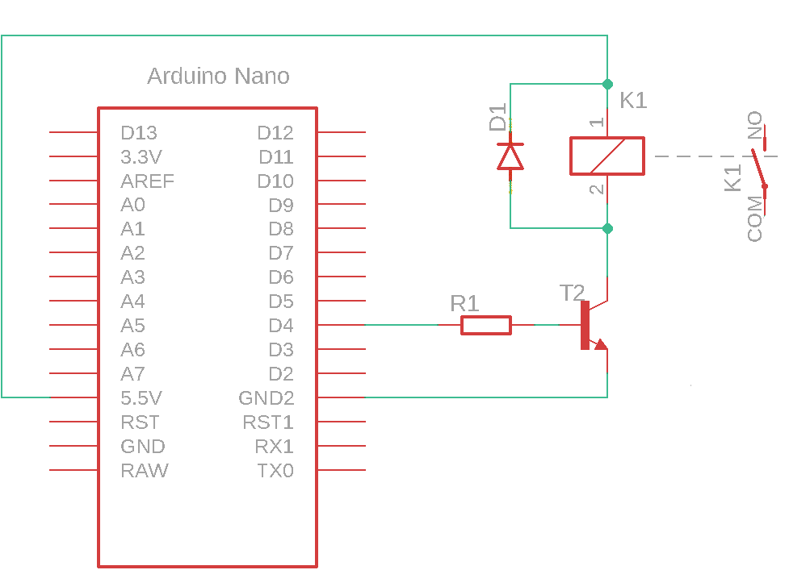
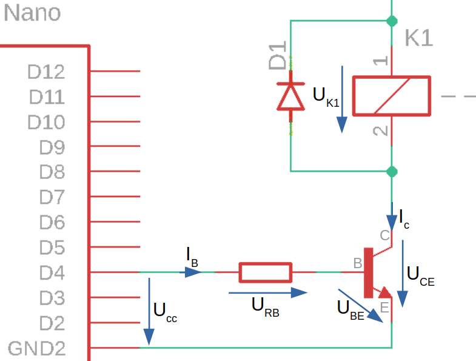
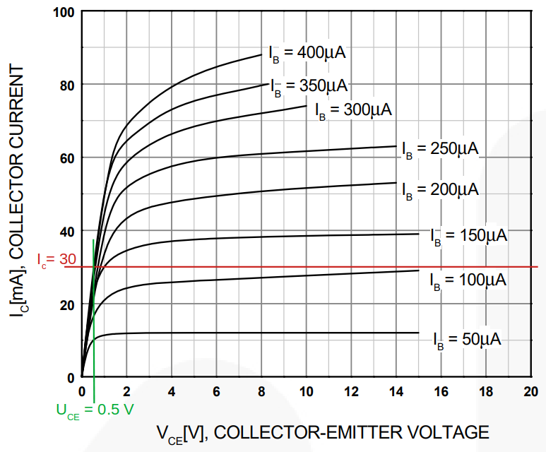

# Relay and microcontroller

A relay provides galvanic isolation between the control circuit and the load circuit. This is useful when:

* an inductive load produces switching transients that could damage the microcontroller's digital output;
* the rated load voltage differs from the digital output voltage;
* the load requires more power than the digital output can provide.

We begin building the circuit by drawing a circuit diagram.

## Circuit diagram

The figure shows how to connect the relay.

<figure><figcaption></figcaption></figure>

Microcontroller pin **D4** is connected to the transistor base through resistor **R1**. Relay coil **K1** is driven by the transistor. Protective diode **D1** is connected across the coil.

Circuit operation:

* When the microcontroller activates the digital output, current flows into the transistor base, turning the transistor on.
* The conducting transistor allows current to flow through the relay coil, energizing the relay.
* The energized relay closes contact **K1**.

## Electrical components

| Component | Part number | Manufacturer | Datasheet |
| --------------- | ------------ | ---------------- | ------------------------------------------------------------------------------------------------------------------------------------------------------------------------------------------------------------------------------- |
| Relay | V23105       | AXICOM           | [datasheet](https://files.gitbook.com/v0/b/gitbook-x-prod.appspot.com/o/spaces%2FOjZ1XG64rvc2AeRBUH5H%2Fuploads%2FNozBDqjgGq8wwq5ogwFr%2FreleyV23105.pdf?alt=media\&token=6e9614c8-4e16-4238-b2bd-0e36a72d839d) |
| transistor | BC550        | ON Semiconductor | [datasheet](https://files.gitbook.com/v0/b/gitbook-x-prod.appspot.com/o/spaces%2FOjZ1XG64rvc2AeRBUH5H%2Fuploads%2FNkIToA5TJdzhLiJa8uWY%2FtranBC550.pdf?alt=media\&token=64e3614f-356d-40e2-867e-8471feb14908) |
| diode | 1N4007       | FairChild        | [datasheet](https://files.gitbook.com/v0/b/gitbook-x-prod.appspot.com/o/spaces%2FOjZ1XG64rvc2AeRBUH5H%2Fuploads%2FVo1DGisQWbUp2fduCfXv%2F1N4007-471020.pdf?alt=media\&token=9852369f-aa20-4b5d-80e7-1aeb8fe76d6a) |
| microcontroller | ATmega328    | Microchip        | [datasheet](https://files.gitbook.com/v0/b/gitbook-x-prod.appspot.com/o/spaces%2FOjZ1XG64rvc2AeRBUH5H%2Fuploads%2FVdyx5L6r6wqAilPGHpen%2FATmega.pdf?alt=media\&token=a7f48452-034e-4411-b859-d87bf77d7454) |
| development board | Arduino Nano | Gravitech        | [datasheet](https://files.gitbook.com/v0/b/gitbook-x-prod.appspot.com/o/spaces%2FOjZ1XG64rvc2AeRBUH5H%2Fuploads%2FmBK4u5xIBnLKRFzfea5q%2FGravitech\_Arduino\_Nano3\_0.pdf?alt=media\&token=b8cb7c7d-aee0-4845-863b-88c382cca882) |
| resistor | /            | Multicomp        | [datasheet](https://files.gitbook.com/v0/b/gitbook-x-prod.appspot.com/o/spaces%2FOjZ1XG64rvc2AeRBUH5H%2Fuploads%2FwniMD8SuO6uL0i9SD8N2%2Fupor.pdf?alt=media\&token=3553e1a0-af07-4fd2-8af3-615a8cee41e7) |

## Component sizing

The following diagram shows the electrical quantities used to calculate the component values.

<figure><figcaption>
Electrical quantities used to calculate component values
</figcaption></figure>

### Base resistor $$R_B$$

Base resistor $$R_B$$ controls the base current and therefore how strongly the transistor conducts. The transistor must conduct enough current to energize the relay.

The relay coil current is also the transistor collector current $$I_C$$. Calculate it from the coil power, which is $$150 mW$$ in this example:

$$
I_{coil}=I_C=\frac{P_{coil}}{U_{rated}}=\frac{150 mW}{5 V}=30 mA
$$

Use the transistor characteristic curves to determine the required base current.

<figure><figcaption></figcaption></figure>

The curves show the relationship between $$U_{CE}$$ and $$I_C$$ for different base currents $$I_B$$. Since the transistor is used as a switch, we want it to dissipate as little power as possible while conducting. For the operating point in this example, we select the highest base current shown, $$I_B = 400 \mu A$$.

The intersection of the selected base-current curve and the relay coil current determines the transistor operating point. At that point, the transistor voltage drop is approximately $$U_{CE} = 0.5V$$.

Calculate the base resistor using:

$$
R_B=\frac{U_{CC}-U_{BE}}{I_B}
$$

Voltage $$U_{BE}$$ is the voltage drop across the transistor's base-emitter junction. It depends on the transistor and is approximately $$0.7 V$$ for a silicon transistor. Consult the transistor datasheet for the applicable value.

$$
U_{BE}=0.7V
$$

The calculated base resistance is:

$$
R_B=\frac{5V - 0.7V}{400 \mu A} \approx 10 k\Omega
$$

### Relay

In this example, the microcontroller supply and the digital output high level are $$5V$$, so we select a relay with a suitable coil voltage. The transistor supplies the relay coil current, rather than drawing that current directly from the digital output.

Check whether voltage drop $$U_{CE}$$ reduces the coil voltage enough to affect relay operation. The resulting coil voltage is:

$$
U_{K1} = U_{CC}-U_{CE}=5V-0.5V=4.5V
$$

According to the relay datasheet used in this example, the minimum coil voltage required for operation is 4.5 V.
