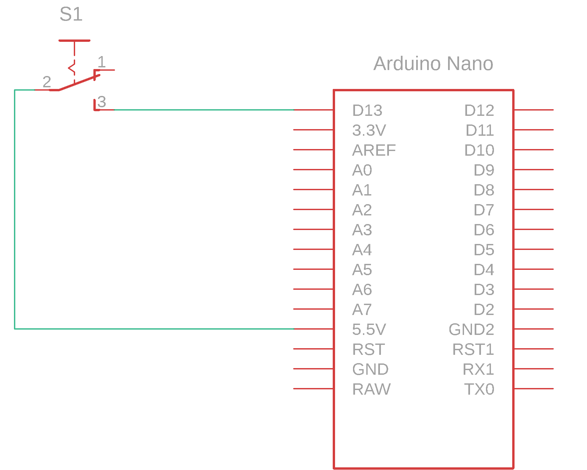
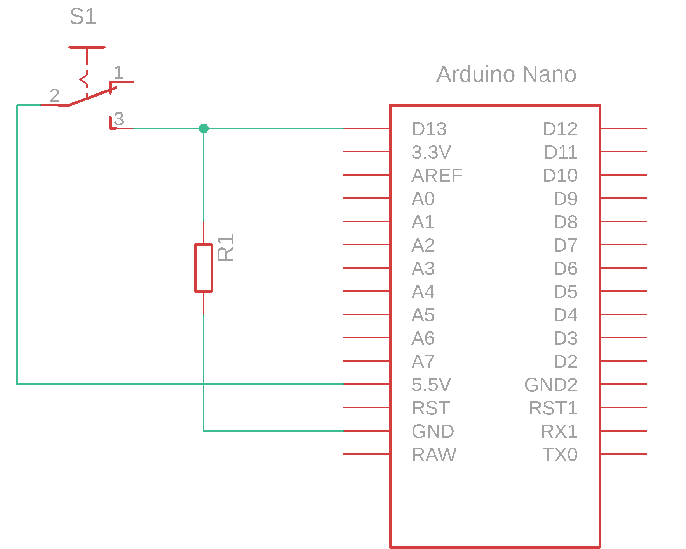

# Button and microcontroller

To transfer information about the state of a button to a microcontroller, we need to build an electrical circuit. We begin by drawing a circuit diagram.

## Circuit diagram

The diagram shows how to connect the button to the microcontroller.

<figure><figcaption>
Connecting a button to the microcontroller
</figcaption></figure>

Button **S1** is connected between the development board's **5V** pin and **D13** pin. The **5V** pin provides _5 V_ whenever the board is powered. A USB connection supplies power, connects the board to the computer and is also used to upload the program.

Circuit operation:

* When the button is pressed, current flows from **5V** to **D13**. The microcontroller input has a high input resistance (approximately _100 MΩ_ in this simplified model), so only a small current flows, on the order of tens of _nA_. The wire resistance and resulting voltage drop are small, so the input voltage is approximately _5 V_.
* When the button is released, the circuit is interrupted and the switch no longer applies a defined voltage to the input.


**CAUTION:** A conductor connected to a microcontroller input at one end and left unconnected at the other can act as an antenna and pick up electromagnetic interference. Since the input has a high impedance, this interference can cause the microcontroller to detect a logic high level.


For reliable operation, add a pull-down resistor. A more detailed explanation is available in the manual. The revised circuit is shown below.

<figure><figcaption>
Connecting the button with an additional pull-down resistor
</figcaption></figure>

When the button is released, the input is no longer floating: resistor **R1** connects it to ground. Interference currents can flow through this resistor instead of creating an undefined input voltage. The resistor has a much lower resistance than the microcontroller input.

### Electrical components

| Component | Part number | Manufacturer | Datasheet |
| --------------- | ------------ | --------------- | ---------------------------------------------------------------------------------------------------------------------------------------------------------------------------------------------------------------------------- |
| button | KS11R22CQD   | C\&K COMPONENTS | [datasheet](https://files.gitbook.com/v0/b/gitbook-x-prod.appspot.com/o/spaces%2FOjZ1XG64rvc2AeRBUH5H%2Fuploads%2FqmBvu21HLP039K5EvO7R%2Ftipka.pdf?alt=media\&token=7a603acd-c208-4158-b49f-55e25430cb83) |
| microcontroller | ATmega328    | Microchip       | [datasheet](https://files.gitbook.com/v0/b/gitbook-x-prod.appspot.com/o/spaces%2FOjZ1XG64rvc2AeRBUH5H%2Fuploads%2FVdyx5L6r6wqAilPGHpen%2FATmega.pdf?alt=media\&token=a7f48452-034e-4411-b859-d87bf77d7454) |
| development board | Arduino Nano | Gravitech       | [datasheet](https://files.gitbook.com/v0/b/gitbook-x-prod.appspot.com/o/spaces%2FOjZ1XG64rvc2AeRBUH5H%2Fuploads%2FmBK4u5xIBnLKRFzfea5q%2FGravitech_Arduino_Nano3_0.pdf?alt=media\&token=b8cb7c7d-aee0-4845-863b-88c382cca882) |
| resistor | /            | Multicomp       | [datasheet](https://files.gitbook.com/v0/b/gitbook-x-prod.appspot.com/o/spaces%2FOjZ1XG64rvc2AeRBUH5H%2Fuploads%2FwniMD8SuO6uL0i9SD8N2%2Fupor.pdf?alt=media\&token=3553e1a0-af07-4fd2-8af3-615a8cee41e7) |

### Component sizing

**Resistor R1**

The resistance must be high enough to avoid excessive power consumption when the button is pressed and low enough to divert interference currents to ground. Although it can be calculated, practical values are often chosen according to the application:

* 3.3 kΩ to 10 kΩ for general use;
* 50 kΩ to 100 kΩ where power consumption is important;
* 200 Ω to 1 kΩ where switching speed is important.
