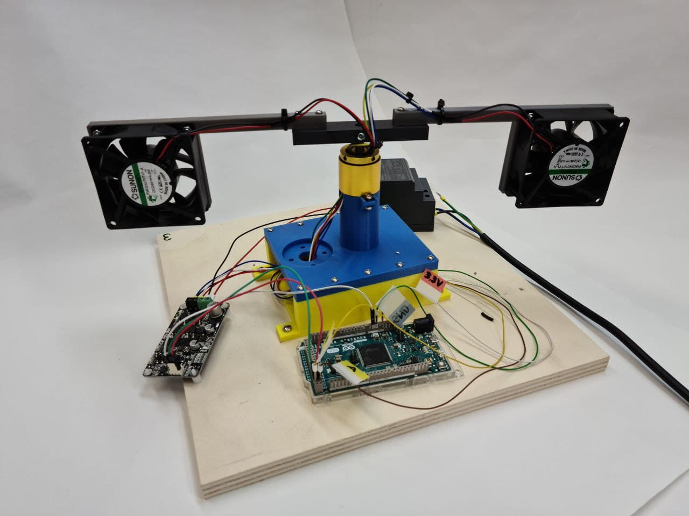
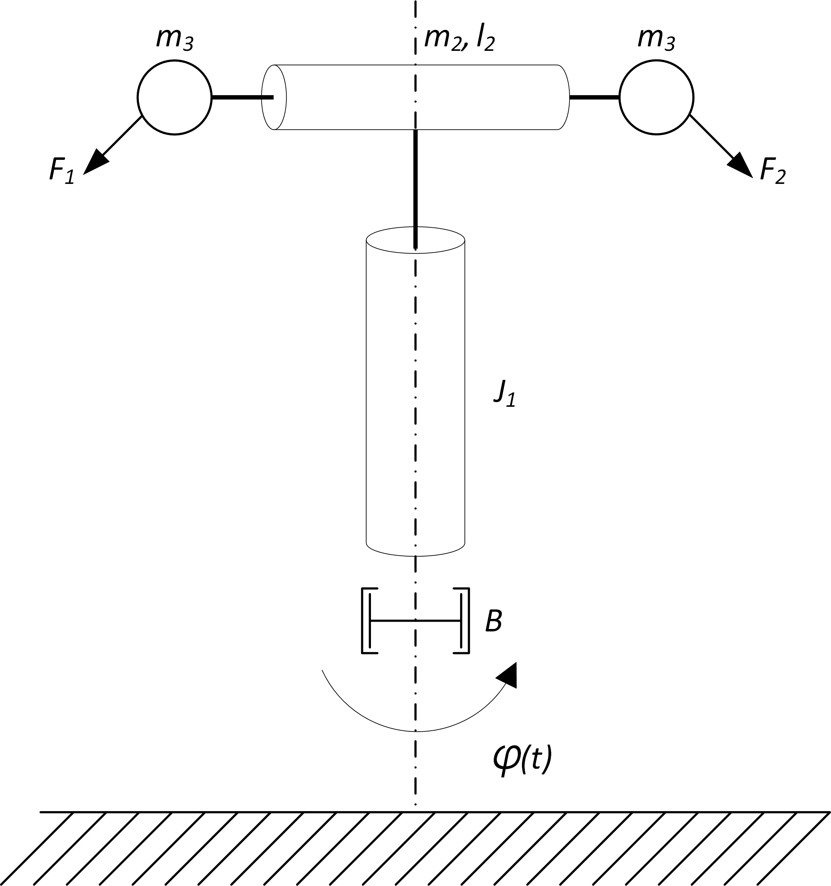

# Aero

<figure><figcaption>
AERO laboratory rig
</figcaption></figure>

## Rig description

AERO is a laboratory rig for studying control of dynamic systems. It consists of a rotating crossbeam with two fan drives that move the beam in the horizontal plane. An angle sensor measures the beam's rotation.

The rig consists of the following components:

* mechanical assembly
* angular encoder
* fan drive
* motor driver
* microcontroller (Arduino Due)
* single-board computer (Raspberry Pi)

The components are connected as shown in the block diagram.

### Mechanical assembly

The rig is a rotating mechanical dynamic system, shown schematically below.

<figure><figcaption>
Mass model of the rig
</figcaption></figure>

The beam rotates about a vertical axis. A fan drive is mounted at each end, represented by point mass $m\_3$. The angle $$varphi(t)$$ describes rotation about the vertical axis. Fan thrust forces $$F_1(t)$$ and $$F_2(t)$$ drive this rotation.

* System variables

| Symbol | Description | Unit |
| ---------------- | ---------------------------------- | ----- |
| $$F_1$$, $$F_2$$ | Force causing the rig to rotate | $$N$$ |
| $$\varphi$$ | Angle of rotation about the vertical axis | $$°$$ |

* System parameters

| Symbol | Description | Value | Unit |
| ------- | --------------------------------- | --------- | -------------- |
| $$B$$ | Damping of the vertical axis | $$0.001$$ | $$kg/s$$ |
| $$J_1$$ | Moment of inertia about the vertical axis | $$0.29$$ | $$g \cdot m²$$ |
| $$m_2$$ | Crossbeam mass | $$90$$ | $$g$$ |
| $$l_2$$ | Horizontal beam length | $$32$$ | $$cm$$ |
| $$m_3$$ | Fan drive mass | $$90$$ | $$g$$ |

### Angular encoder

The vertical axis has an angular encoder: a magnetic incremental [RLS AM4096](https://files.gitbook.com/v0/b/gitbook-x-prod.appspot.com/o/spaces%2FOjZ1XG64rvc2AeRBUH5H%2Fuploads%2FyzCheUulIy3s2L2ZKiW7%2FAM4096D02\_09.pdf?alt=media\&token=98176deb-bbd0-47c8-8e04-4e16f1c4bee7) from the Slovenian company [RLS d.o.o.](https://www.rls.si/). It measures relative shaft motion and sends a digital signal to the microcontroller. The table lists the encoder signals and wire colors for this particular rig; these colors are not a general encoder standard.

| Symbol | Description | Wire color | Input/Output |
| ------- | ----------------------------- | ---------- | ---------- |
| Vcc | 3.3 V or 5 V supply | White | Input |
| GND | Supply ground | Green | Input |
| A | Digital encoder signal A | Brown | Output |
| B | Digital encoder signal B | Yellow | Output |
| Vang | Analog encoder signal | Blue | Output |

### Fan drives

Two identical fan drives rotate the rig about its axis. Each fan drives it in one direction, changing angle $$\varphi$$. Fan drive datasheet.

### Fan motor driver

An MD10C R3 motor driver from [Cytron](https://www.cytron.io/) drives the DC motor.

The driver connects to the two fan drives so that the rig can rotate in either direction. Reversing the driver's output polarity selects which fan operates rather than reversing a fan's rotation. Two digital signals control the driver: $$power$$ is a PWM (Pulse Width Modulation) signal, and $$direction$$ selects the output polarity. A practical driver-control example is provided in the course material.

The table shows thrust as a function of the driver's PWM setting.

| PWM (out of 255) | F\[N] |
| ------------ | ----- |
| 0-175        | 0     |
| 180          | 0.013 |
| 185          | 0.030 |
| 190          | 0.036 |
| 195          | 0.043 |
| 200          | 0.050 |
| 205          | 0.053 |
| 210          | 0.060 |
| 215          | 0.063 |
| 220          | 0.066 |
| 225          | 0.072 |
| 230          | 0.080 |
| 235          | 0.085 |
| 240          | 0.087 |
| 245          | 0.090 |
| 250          | 0.092 |
| 255          | 0.095 |

### Microcontroller

An ARM microcontroller on an Arduino Due development board is used.

### Single-board computer

A Raspberry Pi 4B communicates with the Arduino Due over a serial connection. It also runs the server for the graphical interface used to monitor and control the rig.

## Electrical hardware

The circuit connects the Arduino microcontroller to two incremental encoders and a DC motor driver. The serial connection between the microcontroller and single-board computer is not shown.

The table lists the digital connections to the Arduino.

| Device | Pin | Arduino pin | Signal label | Input/Output |
| -------- | --- | ----------- | --------------- | ---------- |
| RMK4 Fi | A | 22 | A1 | Input |
| RMK4 Fi | B | 23 | B1 | Input |
| MD10C-R3 | DIR | 2 | DIR | Output |
| MD10C-R3 | PWM | 3 | PWM | Output |

### Electrical components

List of electrical components used:

<table><thead><tr><th>Component</th><th width="461">Part number</th><th>Manufacturer</th><th>Datasheet</th></tr></thead><tbody><tr><td>incremental encoder</td><td>RLS AM4096</td><td><a href="https://www.rls.si/">RLS d.o.o.</a></td><td><a href="https://files.gitbook.com/v0/b/gitbook-x-prod.appspot.com/o/spaces%2FOjZ1XG64rvc2AeRBUH5H%2Fuploads%2FyzCheUulIy3s2L2ZKiW7%2FAM4096D02_09.pdf?alt=media&#x26;token=98176deb-bbd0-47c8-8e04-4e16f1c4bee7">file</a></td></tr><tr><td>fan motor driver</td><td>MD10C R3</td><td><a href="https://www.cytron.io/">Cytron</a></td><td>file</td></tr><tr><td>microcontroller</td><td>SAM3X8E ARM</td><td><a href="https://www.microchip.com/">Microchip</a></td><td>file</td></tr><tr><td>development board</td><td>Arduino Due</td><td><a href="https://www.arduino.cc/">Arduino</a></td><td>file</td></tr><tr><td>single-board computer</td><td>RaspberryPi 4B 4GB</td><td><a href="https://www.raspberrypi.org/">RaspberryPi</a></td><td>file</td></tr></tbody></table>

