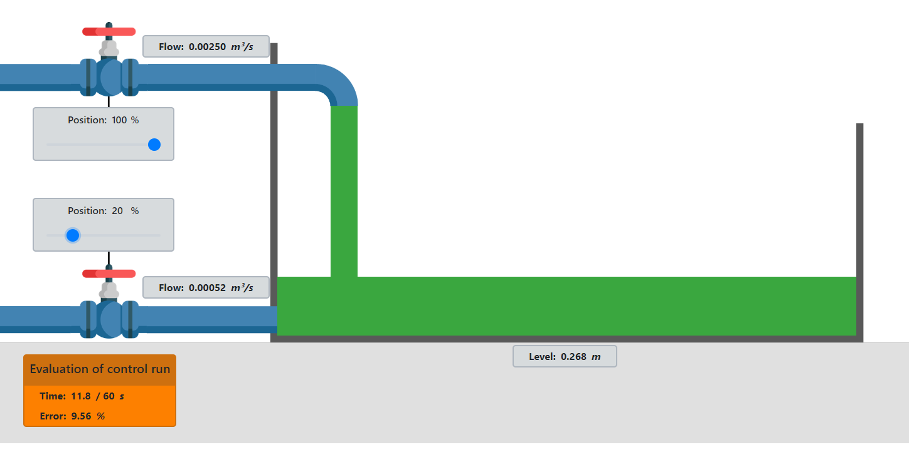

# HidroTank emulator

### 1. Description

The rig simulates a simple fluid system in real time. The system consists of a tank, an inlet valve and an outlet valve. It can be controlled manually or using a mechanical controller.

### 2. Open-loop model

The figure shows the open-loop system: an inlet valve with an inlet flow meter, a tank, and an outlet valve with an outlet flow meter.

<figure><figcaption>
Open-loop model
</figcaption></figure>

#### 2.1 Inlet valve

The inlet valve supplies fluid to the tank. Inlet flow as a function of valve opening (Position) is described by:

$$
\varphi_{\text{inlet}}(\text{valve}) = 0.0025 \, \left[\frac{\text{m}^3}{\text{s}}\right] \cdot \text{valve} \, [\%]
$$

Valve opening and flow have a linear relationship, limited at 100% opening. A flow meter measures the current flow (Flow), displayed to the left of the valve.

#### 2.2 Outlet valve

The outlet valve drains fluid from the tank. Outlet flow depends on valve opening and fluid level $$h(t)$$:

$$
\varphi_{\text{outlet}}(\text{valve}, h) = 0.005 \, \left[\frac{\text{m}^3}{\text{s}}\right] \cdot \text{valve} \, [\%] \cdot \sqrt{2 \cdot g \cdot h(t)}
$$

Maximum outlet flow occurs at the highest fluid level ($$h = 1 , \text{m}$$) with the valve fully open ($$\text{valve} = 100%$$).

#### 2.3 Tank

The fluid level in the tank is described by:

$$
h(t) = \int \frac{1}{S_{\text{tank}}} \left( \varphi_{\text{inlet}}(t) - \varphi_{\text{outlet}}(t) \right) \, dt
$$

The fluid level depends on the tank geometry, the integrated difference between inlet and outlet flow, and the initial level implicit in the integral. The tank is rectangular, with cross-sectional area $$S = 0.1 , \text{m}^2$$ and a maximum height of $$1 \text{m}$$. The minimum fluid level is $$0 \text{m}$$; levels above $$1 \text{m}$$ cause overflow.

#### 2.4 System block diagram

The block diagram shows the components and their connections. The inlet valve sets the incoming flow. The outlet valve sets the outgoing flow, which is subtracted from the incoming flow. The flow difference changes the tank's fluid level $$h(t)$$.

<figure><figcaption>
Open-loop system block diagram
</figcaption></figure>

### 3. Closed-loop model

Closed-loop operation controls the valves to achieve a specified fluid level in the tank. In open-loop operation, no feedback-based level-control requirement is imposed.

<figure><figcaption>
Closed-loop system block diagram
</figcaption></figure>

The closed-loop system specifies reference level $$h_{\text{ref}}(t)$$. The difference between reference and actual level is error $$e(t) = h_{\text{ref}}(t) - h(t)$$. The controller uses this error to calculate valve opening $$u(t)$$, and therefore inlet flow, to reduce the error.

The rig supports two controller types:

* Manual control system
* Mechanical control system

#### 3.1 Manual control system

An operator controls the valves manually, monitoring the reference level and opening or closing the valves as required.

#### 3.2 Mechanical control system

Mechanical feedback controls the inlet valve.

<figure><figcaption>
Mechanical control system
</figcaption></figure>

A float and a system of mechanical levers control the inlet valve.

**Mechanical parameters**

| Symbol | Value | Unit | Note |
| ------ | ----------- | ----- | ------------------ |
| l1 | 0.4 | m | Fixed lever arm |
| l2 | 0.5 | m | Fixed lever arm |
| l3 | \[0.5, 3.0] | m | Adjustable lever arm |
| l4 | \[0.5, 3.0] | m | Adjustable lever arm |
| float | 0.142 | m | Float height |

**Point locations relative to point C**

| Symbol | Location (x, y) | Unit | Note |
| ------ | --------------- | ----- | --------------------------------- |
| A | \[-0.75, y] | m | Free vertical movement |
| B | \[x, y] | m | Variable point |
| C | \[0, 0] | m | Fixed point |
| D | \[0.5, 3.0] | m | Variable point |
| E | \[1.34, y] | m | Free vertical movement |

Point A controls the inlet valve within its travel limits. The valve is closed (0%) when A is more than 0.31 m below C and fully open when A is more than 0.085 m above C. Intermediate positions follow a linear relationship between the endpoints.
