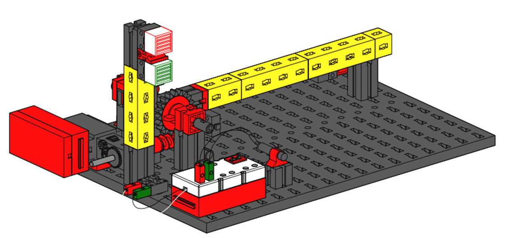
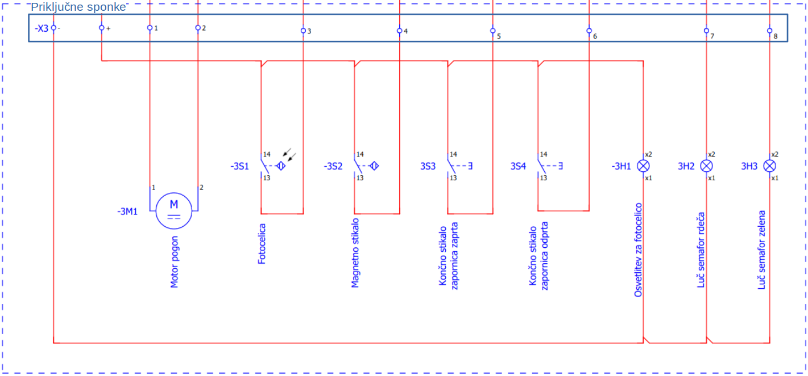
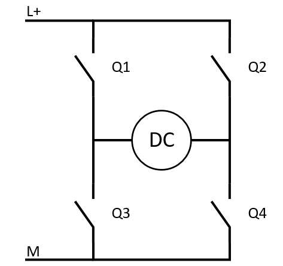
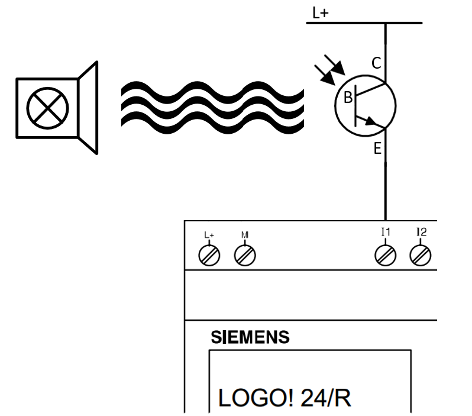

# Parking barrier

The parking barrier rig is a teaching aid that reproduces the behavior of a real barrier. It can be automated using a controller.

<figure><figcaption>
Parking barrier rig diagram
</figcaption></figure>

### Rig components

The rig consists of the following components:

* geared electric motor driving the barrier
* limit switches detecting the barrier's end positions
* photoelectric sensor detecting a vehicle under the barrier
* magnetic switch detecting a vehicle in front of the barrier
* red and green traffic lights signaling to the driver
* connection terminals

### Circuit diagram

The components are connected as shown in the circuit diagram.

<figure><figcaption></figcaption></figure>


Power the rig with **12 V DC**. Connect the positive supply to terminal **X3 +** and the negative supply to **X3 -**.


### Component connection examples

The rig allows different ways to integrate its components into a control system. The following sections provide an example connection for each component.

#### Geared motor

A DC motor and reduction gearing drive the mechanism. The current direction determines the motor's rotation direction. The figure shows bidirectional motor control using four relays arranged as an H-bridge.

<figure><figcaption>
DC motor connected to an H-bridge using four relays
</figcaption></figure>

Energizing relays _Q1_ and _Q4_ allows current to flow from positive supply _L+_ through _Q1_ to the motor's left terminal, then from its right terminal through _Q4_ to negative supply _M_. Energizing _Q2_ and _Q3_ reverses the current through the motor and therefore its rotation direction.

#### Photoelectric sensor

The photoelectric sensor changes its digital state when an object blocks the path between its light source and receiver. The source is a powered lamp, and the receiver is a phototransistor. The figure shows the sensor and an example controller connection.

<figure><figcaption>
Connecting a photoelectric sensor to a PLC digital input
</figcaption></figure>

When an object blocks the light reaching the phototransistor, the transistor turns off. Current no longer flows from positive supply _L+_ through the transistor to the controller input, which is detected as logic 0.
