# Siemens LOGO

The Siemens LOGO PLC is an entry-level controller for industrial applications.

Resources:

* [User manual](https://files.gitbook.com/v0/b/gitbook-x-prod.appspot.com/o/spaces%2FOjZ1XG64rvc2AeRBUH5H%2Fuploads%2FMkk9RqfREhqdDBbizIOP%2Flogo\_manual.pdf?alt=media\&token=1bed8ffc-09b1-4e37-b233-91a7d7290fe4)
* [LogoSoftComfort V8.0 Demo](https://drive.google.com/file/d/1OZgJ\_CZv5HBBtY1p7byRcTMdeE-Z-HyA/view?usp=sharing)
* [LogoSoftComfort V6.0 (for educational use only)](https://drive.google.com/file/d/1OKeYmfERUlauEAGMq-3-49qWQ3DHIwju/view?usp=sharing)

## Controller description

The figure shows the PLC with its components labeled. The LOGO PLC uses a 32-bit ARM STR910FAW32 microcontroller. It has eight digital inputs and four outputs, allowing eight external digital signals to be monitored and four relay-controlled outputs to be operated.

<figure>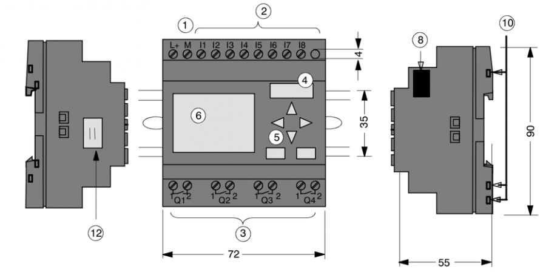<figcaption>
Siemens LOGO
</figcaption></figure>

PLC components: 1 power connection, 2 input terminals, 3 output terminals, 4 programming connector, 5 control buttons, 6 LCD display, 8 expansion-module interface, and 12 external LCD interface.

## Electrical wiring

Connect the controller to its power supply, digital inputs and digital outputs.

### PLC power supply

The PLC requires a power supply; this example uses 24 V DC. The figure shows the supply connection.

<figure>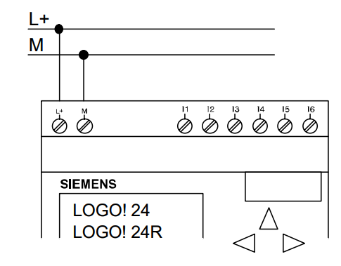<figcaption>
Connecting the power supply
</figcaption></figure>

In the figure, **L+** is the positive supply terminal and **M** is the negative supply terminal.

### Digital inputs

Digital inputs monitor devices such as limit switches, pressure switches and other digital sensors. The figure shows an example switch connection.

<figure>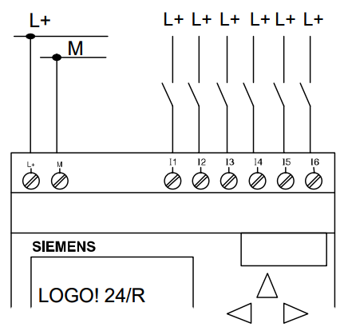<figcaption>
Connecting switches to digital inputs
</figcaption></figure>

### Digital outputs

Digital outputs operate devices such as lamps, relays, motors and pumps. Some PLC versions provide built-in relays Q1, Q2, Q3 and Q4, giving four software-controlled switches. The figure shows a load connected to a digital output.

<figure>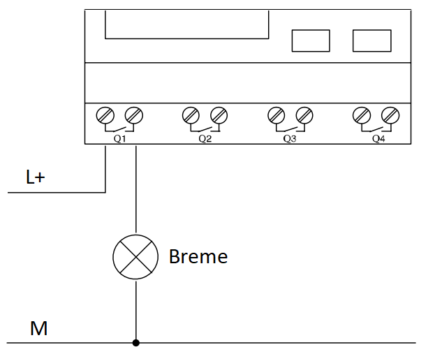<figcaption>
Connecting loads to digital outputs
</figcaption></figure>

The PLC relay output switches the load through a relay contact. Connect positive supply **L+** to one contact terminal and the load to the other. Connect the load's other terminal to negative supply **M**.

### User interface

The interface consists of an alphanumeric LCD and four buttons. System screens show the program state and digital input/output states and allow basic program editing. User-defined screens are configured in the programming software. The figure shows input/output monitoring.

<figure>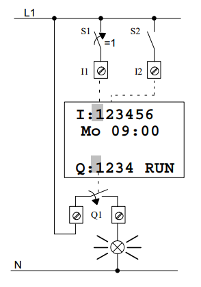<figcaption>
Displaying digital input I1 and output Q1
</figcaption></figure>

When switch S1 closes, digit 1 in the first display row is highlighted, indicating logic 1. It is not highlighted when S1 is open. Similarly, setting output Q1 to logic 1 highlights digit 1 in the last row. User-defined screens can display text, integers and decimal numbers.

## Programming software

LOGO! Soft Comfort is used to program the LOGO PLC. The demo version supports simulation but does not allow programs to be transferred to the controller.

### Programming

The software supports Function Block Diagram (FBD) and Ladder Diagram (LAD). Select the language when creating a new project, as shown below.

<figure>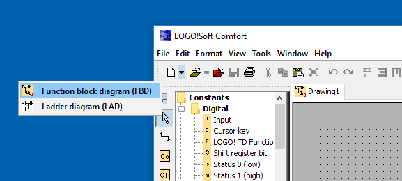<figcaption>
Creating a new program
</figcaption></figure>

FBD programming uses graphical placement and wiring of function blocks from the library. The figure shows the block representing the controller's first digital input placed in the program.

<figure><figcaption>
Placing a digital input function block in the program
</figcaption></figure>

Other available blocks include AND and OR logic, RS flip-flops, timers, counters and additional functions.

### Program simulation

Simulation checks program behavior without affecting physical digital outputs, allowing testing in an isolated virtual environment. The figure shows how to start the simulator.

<figure>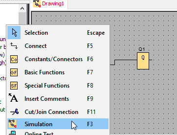<figcaption>
Select simulation from the menu with a left mouse click
</figcaption></figure>

Control the simulator using the toolbar below the diagram. You can change virtual inputs and observe the blocks' responses. In the illustrated simulator, blue blocks and connections represent logic 1; red represents logic 0. A red border on output Q indicates an inactive output, while blue indicates an active output. The figure shows an active input connected to an output, with the signal path highlighted in blue.

<figure>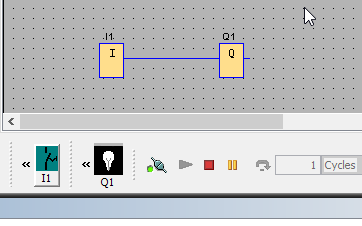<figcaption>
Displaying states in program simulation mode
</figcaption></figure>

### Communication interface setup

Before programming the controller for the first time, connect it to the computer through the programming interface. Windows detects the connected interface and installs its drivers. Configure the interface in LOGO! Soft Comfort under **Tools** $$\rightarrow$$ **Options**, as shown below.

<figure>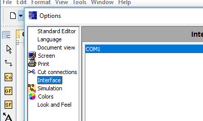<figcaption>
Configuring the serial interface
</figcaption></figure>

### Uploading the program to the controller

Transfer the program using the toolbar shown below.

<figure>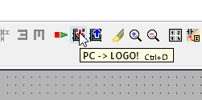<figcaption>
Uploading the program to the PLC
</figcaption></figure>

After transferring the program, start it explicitly. For safety, the controller does not automatically start a newly uploaded program. Start it from the controller display or the programming software.

### Program monitoring

Real-time monitoring provides a closer view of program execution and helps with debugging. Right-click the diagram to access the monitoring function, as shown below.

<figure>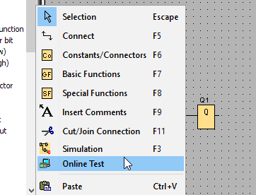<figcaption>
Online Test displays the current program's variable and block states
</figcaption></figure>

Monitoring displays program states similarly to simulation, but physical input states cannot be changed in software; they depend on the devices connected to the PLC.

## Controller operation example

The figure shows the PLC and its digital input/output connections.

<figure>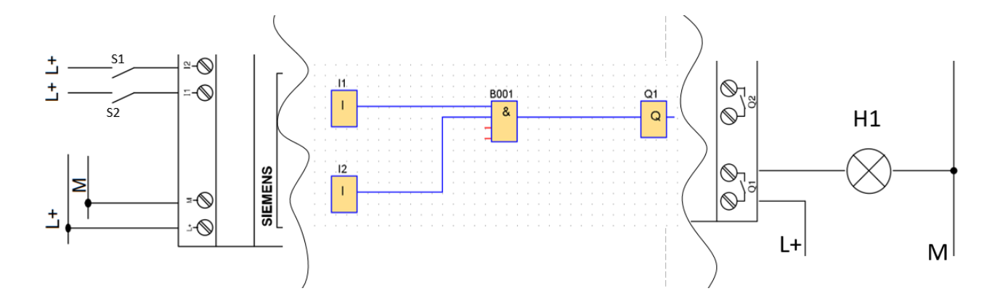<figcaption>
Information passing from the source (switches) through the PLC to the destination (lamp)
</figcaption></figure>

The example connects switches S1 and S2 to inputs I1 and I2, and lamp H1 to output Q1. In the FBD program, the switches are represented by input blocks I1 and I2. Pressing a switch sets its block output to logic 1. Both input blocks feed an AND block (&), which outputs logic 1 only when both inputs are high. Its output drives block Q1, closing the output relay and switching on lamp H1.
