# Simatic 1200

## PLC electrical wiring

### Power supply connection

### Digital input connection

### Digital output connection

### DC motor H-bridge connection

## Programming

### First startup

1. Find TIA Portal V18 on your computer and start it.

<figure><figcaption>
Starting TIA Portal
</figcaption></figure>

2. When the application opens, select _Create new project_.

<figure>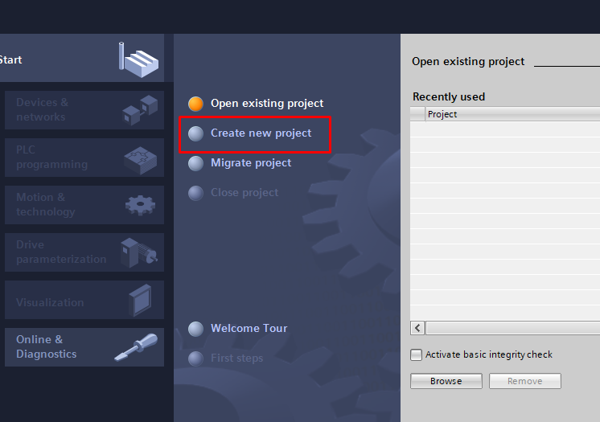<figcaption>
TIA Portal startup screen
</figcaption></figure>

3. Enter a name for the new project and confirm.

<figure>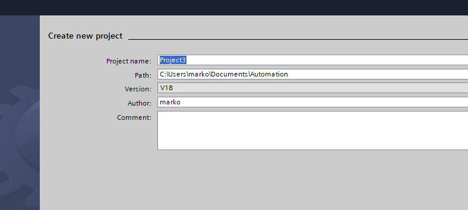<figcaption>
Creating a new project
</figcaption></figure>

4. When the project is created, select _Configure a device_.

<figure>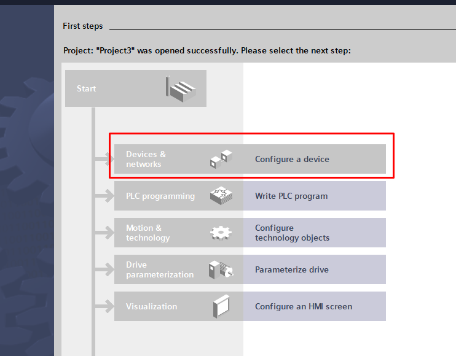<figcaption>
Project development options
</figcaption></figure>

5. Add a new device using the option shown below.

<figure>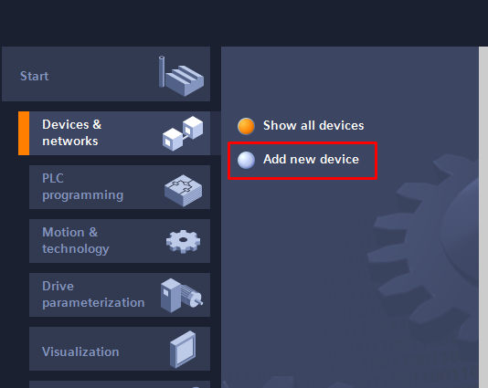<figcaption>
Devices and the option to add a new device
</figcaption></figure>

6. Select the correct device. Match both the CPU (central processing unit) and input/output configuration to the identifier on the side of the PLC.

<figure>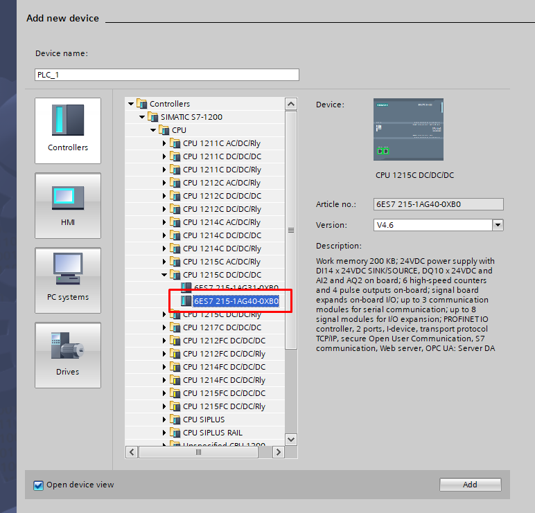<figcaption>
Selecting the PLC configuration
</figcaption></figure>

7. Select the firmware version used by the PLC. This example uses _V4.5_.

<figure>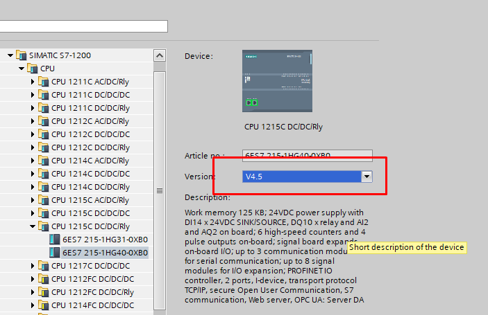<figcaption>
Selecting the PLC firmware
</figcaption></figure>

<figure>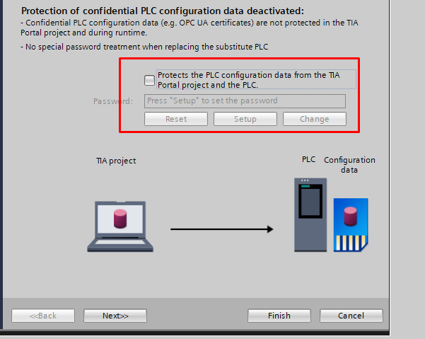<figcaption></figcaption></figure>

<figure>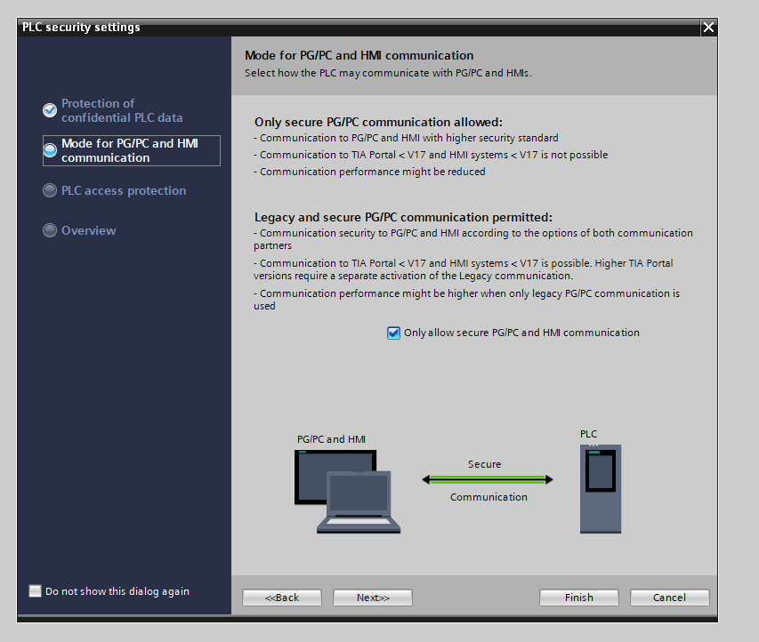<figcaption></figcaption></figure>

<figure>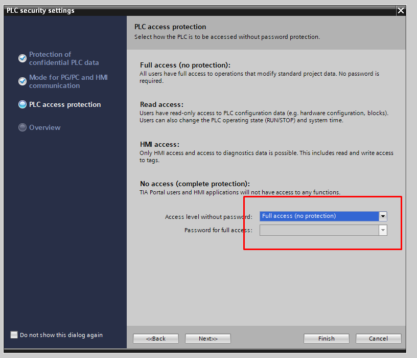<figcaption></figcaption></figure>

<figure>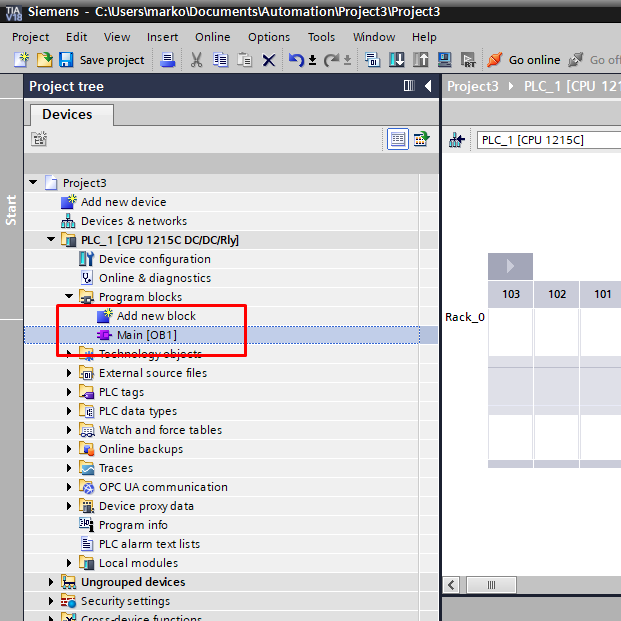<figcaption></figcaption></figure>

<figure>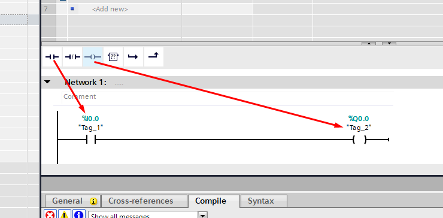<figcaption></figcaption></figure>

<figure>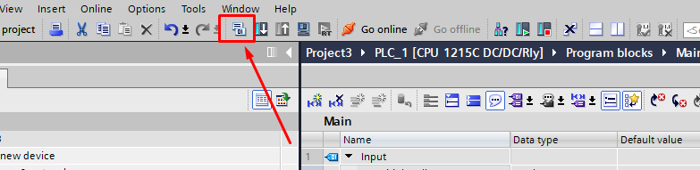<figcaption></figcaption></figure>

<figure>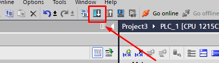<figcaption></figcaption></figure>

<figure>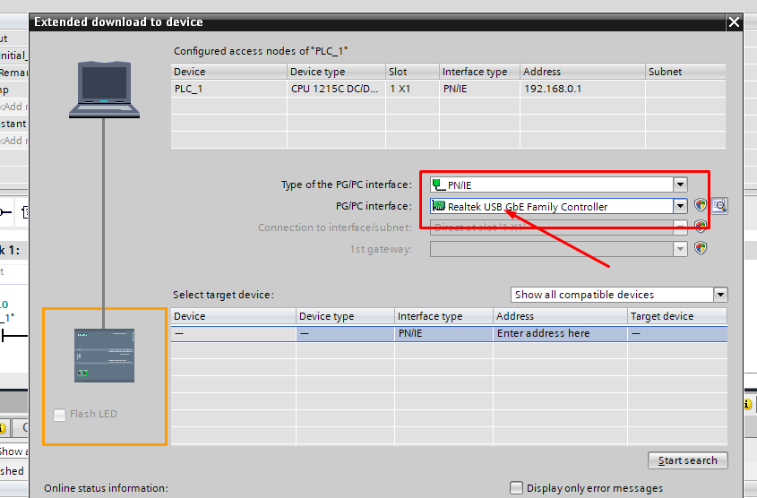<figcaption></figcaption></figure>

<figure>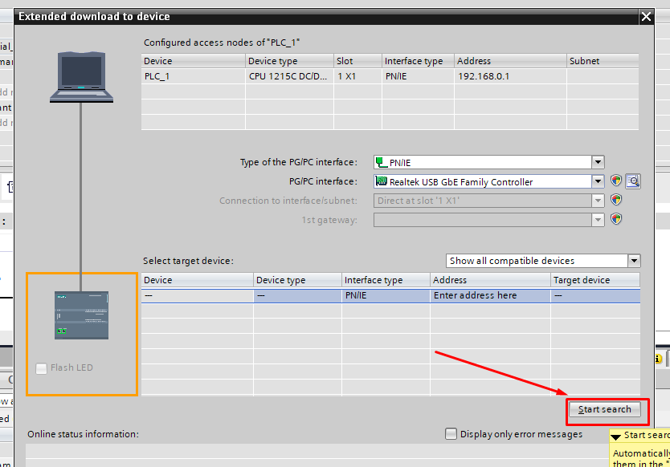<figcaption>
TIA Portal configuration screen
</figcaption></figure>

<figure>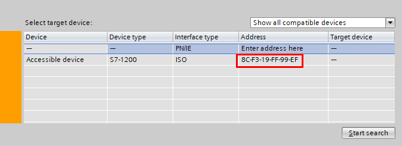<figcaption></figcaption></figure>

<figure>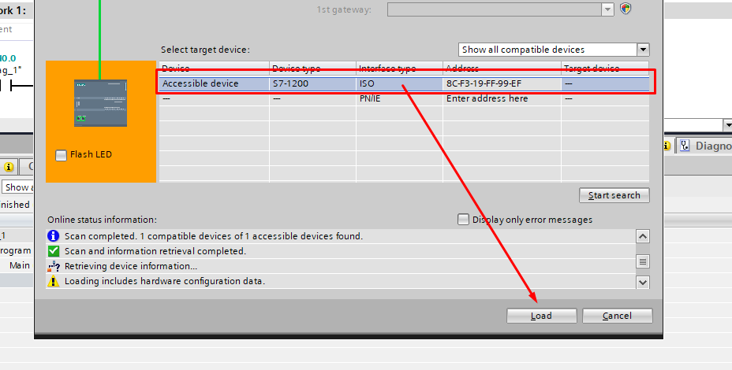<figcaption></figcaption></figure>

<figure>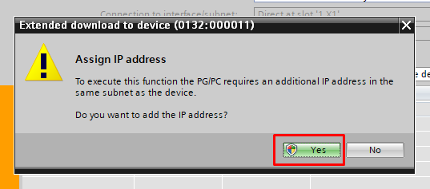<figcaption></figcaption></figure>

<figure>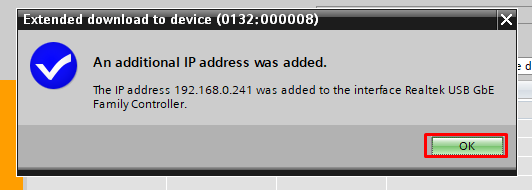<figcaption></figcaption></figure>

<figure>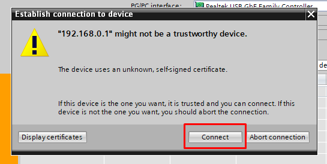<figcaption></figcaption></figure>

<figure>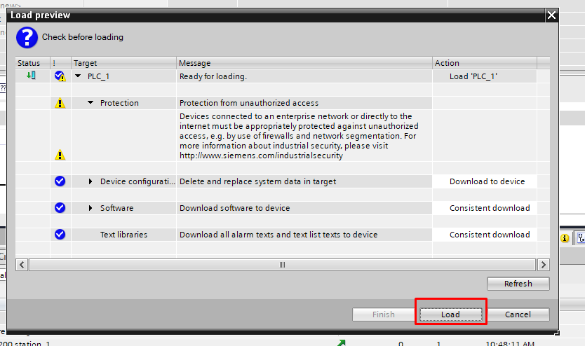<figcaption></figcaption></figure>

<figure>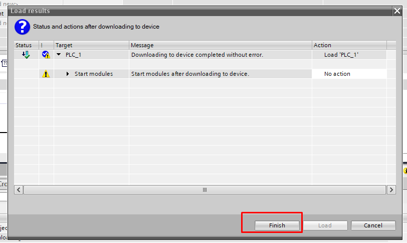<figcaption></figcaption></figure>

<figure>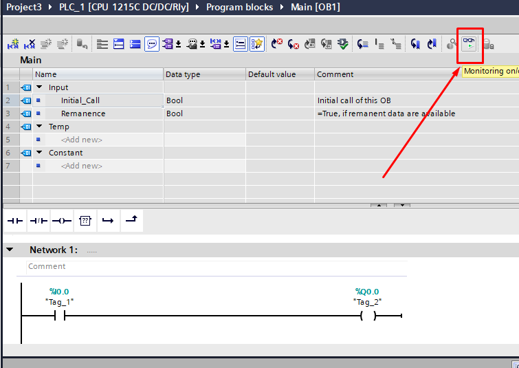<figcaption></figcaption></figure>

<figure>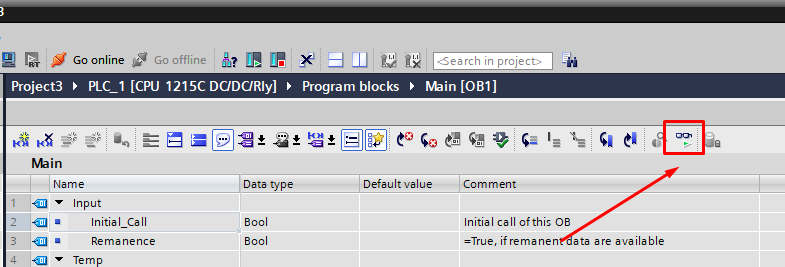<figcaption></figcaption></figure>

<figure>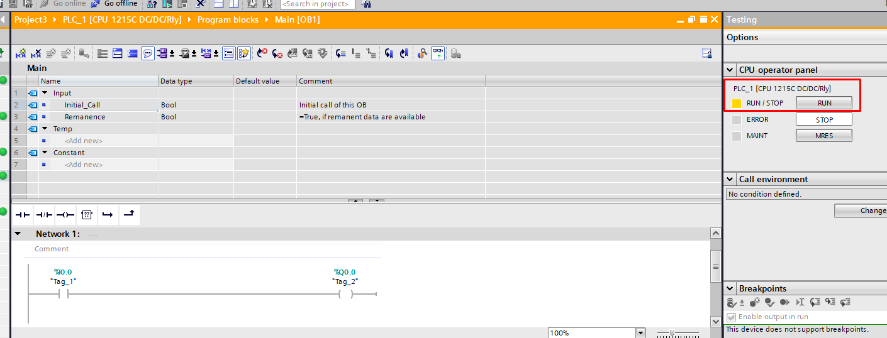<figcaption></figcaption></figure>

<figure>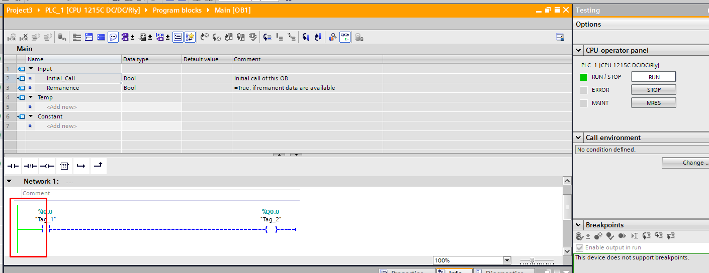<figcaption></figcaption></figure>
