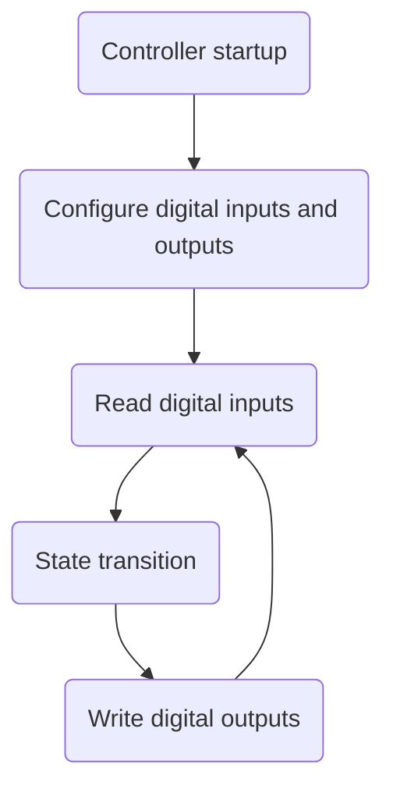
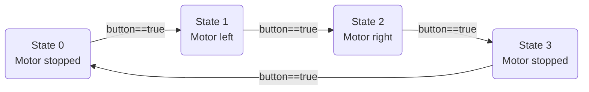
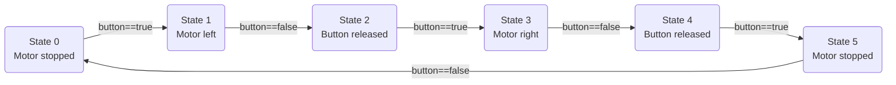

# Implementing a Moore state machine

## Implementing a Moore state machine

We will build a DC motor control system with the following required behavior:

1. The first button press starts the motor in the left direction.
2. The second button press stops the motor.
3. The third button press starts the motor in the right direction.
4. The fourth button press stops the motor.
5. The sequence repeats indefinitely.

We need to build the electrical circuit and write the program.

### Electrical circuit

The circuit needs a button and a bidirectional motor driver. See [Button and microcontroller](../elektrotehnika/tipka-in-mikrokrmilnik.md) for the button circuit and [DC motor and microcontroller](../elektrotehnika/enosmerni-motor-in-mikrokrmilnik.md) for motor control in both directions.

### Program code

We can represent this controller as a Moore finite-state machine. Its outputs depend only on the current state. Inputs affect state transitions, so they influence the outputs indirectly. The following flowchart shows the general implementation.



The state machine operates as follows:

1. The controller starts when power is connected.
2. Configure the controller.
3. Read and store the digital input values.
4. Execute one state transition step.
5. Write the new digital output values.
6. Return to reading the digital inputs.

The loop runs indefinitely, until the controller is powered off.

#### Defining the controller state machine

Use the task description to draw a state-transition diagram for the Moore machine.



!> CAUTION: Because the state machine runs in a loop, take care when a digital input level is used as a transition condition. See the course material for more information.

The following state-transition diagram accounts for the digital input being held active.



#### Converting the state machine to code

We will use functions from the Arduino library when writing the code.

* [pinMode()](https://www.arduino.cc/reference/en/language/functions/digital-io/pinmode/)
* [digitalRead()](https://www.arduino.cc/reference/en/language/functions/digital-io/digitalread/)
* [digitalWrite()](https://www.arduino.cc/reference/en/language/functions/digital-io/digitalwrite/)

Convert the entire Moore state machine, including input reads, state transitions and output writes, into Arduino C code. The $setMotorOutputs()$ function writes the motor control outputs.

```c
//Global constants
//Digital input pins
int S0pin = 0; //button
//Digital output pins
int Q1pin = 1;  //relay 1
int Q2pin = 2;  //relay 2
int Q3pin = 3;  //relay 3
int Q4pin = 4;  //relay 4

//Global variables
bool S0 = false;  //Button state variable
int state = 0;  //State-machine state variable
int motor = 0;  //Motor state: 0/1/2 = stopped/left/right

//Setup function
void setup() {
  pinMode(S0pin, INPUT);  //Configure pin 0 as a digital input
  //Configure pins 1, 2, 3 and 4 as digital outputs for the motor H-bridge
  pinMode(Q1pin, OUTPUT);
  pinMode(Q2pin, OUTPUT);
  pinMode(Q3pin, OUTPUT);
  pinMode(Q4pin, OUTPUT);
}

//Main loop
void loop() {
  //Read the digital input values
  S0 = digitalRead(S0pin);
  //State transition
  switch (state) {
    //State 0: motor stopped
    case 0: {
        if (S0 == true) { //Is the button pressed?
          state++;  //Change state
          motor = 1;  //Select left motor rotation
        }
      } break;
    // State 1: motor rotating left
    case 1: {
        if (S0 == false) {  //Is the button released?
          state++;  //Change state
        }
      } break;
    // State 2: button released
    case 2: {
        if (S0 == true) { //Is the button pressed?
          state++;  //Change state
          motor = 2;  //Select right motor rotation
        }
      } break;
    // State 3: motor rotating right
    case 3: {
        if (S0 == false) {  //Is the button released?
          state++;  //Change state
        }
      } break;
    // State 4: button released
    case 4: {
        if (S0 == true) { //Is the button pressed?
          state++;  //Change state
          motor = 0;  //Stop the motor
        }
      } break;
    // State 5: motor stopped
    case 5: {
        if (S0 == false) {  //Is the button released?
          state = 0;  //Change state
        }
      } break;
  }
  //Write the digital output values
  setMotorOutputs(motor);
}

//Motor control function
void setMotorOutputs(int direction) {
  //Motor stopped
  if (direction == 0) {
    digitalWrite(Q1pin, LOW);
    digitalWrite(Q2pin, LOW);
    digitalWrite(Q3pin, LOW);
    digitalWrite(Q4pin, LOW);
  }
  //Motor left
  if (direction == 1) {
    digitalWrite(Q1pin, HIGH);
    digitalWrite(Q2pin, HIGH);
    digitalWrite(Q3pin, LOW);
    digitalWrite(Q4pin, LOW);
  }
  //Motor right
  if (direction == 2) {
    digitalWrite(Q1pin, LOW);
    digitalWrite(Q2pin, LOW);
    digitalWrite(Q3pin, HIGH);
    digitalWrite(Q4pin, HIGH);
  }
}
```
