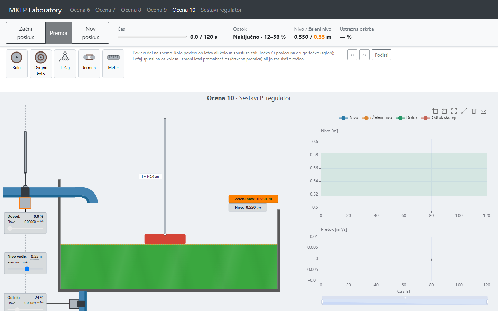
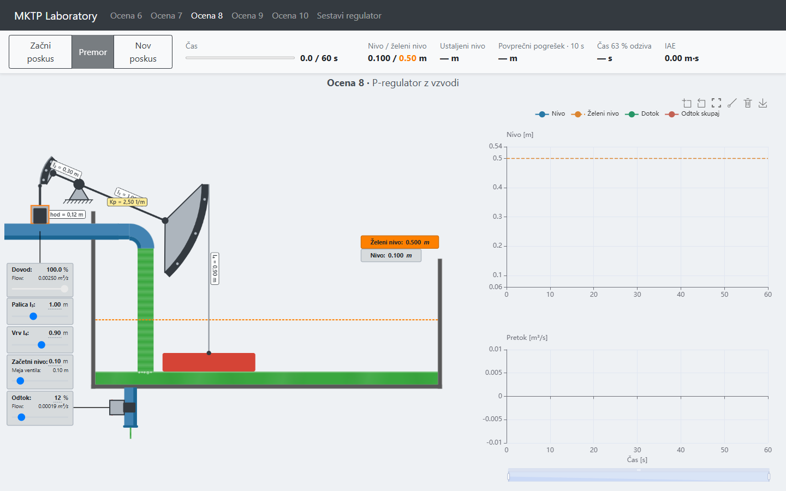
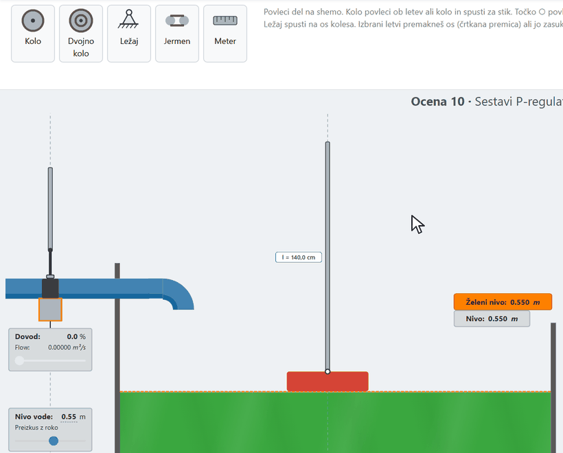
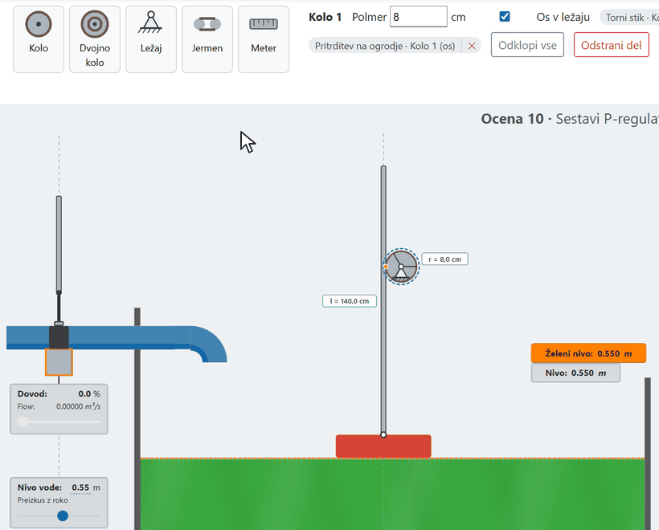
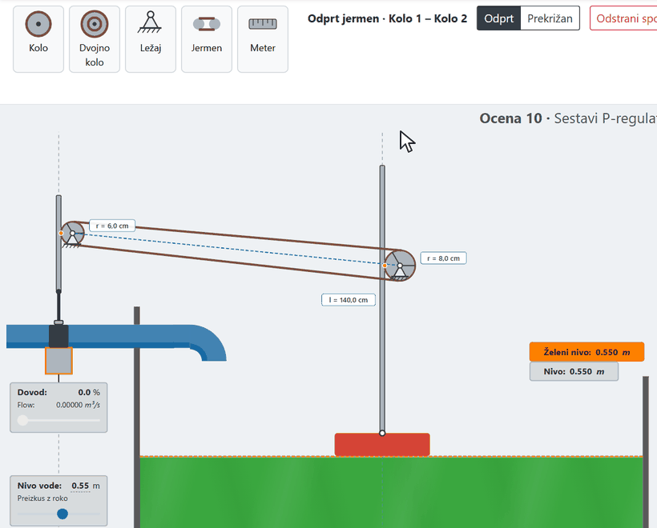
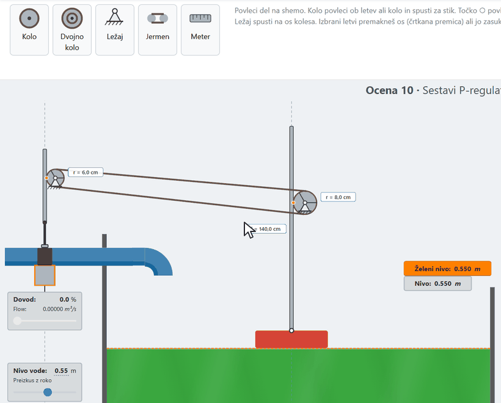
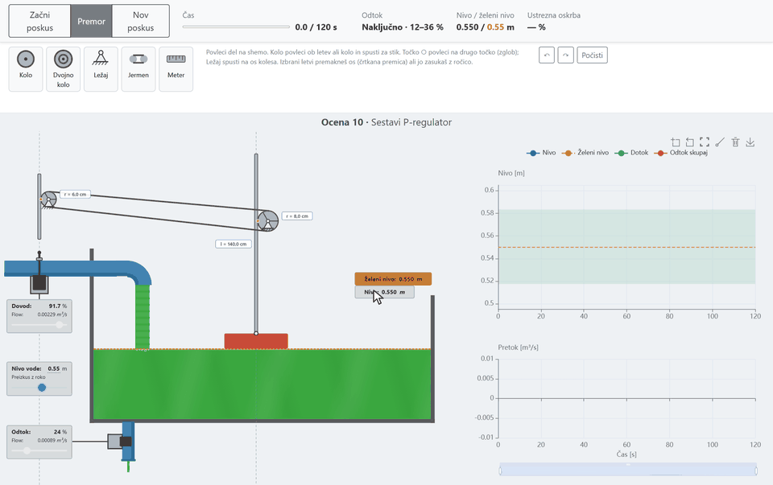

# HidroTank emulator

### Zagon

Maketa je ena sama datoteka HTML in ne potrebuje namestitve, strežnika ali internetne povezave.

1. Klikni povezavo [hidrotank-emulator.html](../../.gitbook/assets/hidrotank-emulator.html); datoteka se prenese v mapo Prenosi.
2. Odpri preneseno datoteko z dvoklikom ali jo povleci v okno brskalnika (Chrome, Edge ali Firefox).
3. Maketa se odpre v brskalniku. Sestavljeni mehanizmi se shranijo v brskalnik in ostanejo tudi po ponovnem odprtju datoteke.

### 1. Opis

HidroTank emulator je spletna aplikacija, ki v realnem času simulira enostaven tekočinski sistem: hranilnik z dovodnim ventilom na vrhu in odvodnim ventilom (odtokom) na dnu. Sistem je mogoče opazovati brez regulatorja, ga voditi ročno ali z mehanskim P-regulatorjem. Mehanski regulator je lahko vnaprej pripravljen (z vzvodi) ali pa ga uporabnik sam sestavi iz koles, ležajev in jermenov.

Vsak način delovanja prikazuje shemo sistema, nastavitve, meritve in graf.

<figure><figcaption>
Sestavljanje regulatorja: zgoraj paleta delov, levo shema z letvijo ventila in plovcem, desno graf
</figcaption></figure>

### 2. Model sistema

#### 2.1 Dovodni ventil

Dovodni ventil je batni ventil s hodom $$0.12 \, \text{m}$$ od zaprtega do popolnoma odprtega položaja. Dovodni pretok je linearen z odprtostjo ventila $$u_{\text{dov}}$$ [%]:

$$
\varphi_{\text{dovodni}} = 0.0025 \, \left[\frac{\text{m}^3}{\text{s}}\right] \cdot \frac{u_{\text{dov}}}{100}
$$

#### 2.2 Odvodni ventil

Odvodni pretok je odvisen od odprtosti odtoka $$u_{\text{odv}}$$ [%] in nivoja $$h$$:

$$
\varphi_{\text{odvodni}} = \frac{u_{\text{odv}}}{100} \cdot \frac{\sqrt{2 g h}}{k}, \qquad k = 885.89
$$

Pri polnem hranilniku ($$h = 1 \, \text{m}$$) in popolnoma odprtem odtoku je odvodni pretok približno $$0.005 \, \text{m}^3/\text{s}$$.

#### 2.3 Hranilnik

Hranilnik ima površino $$A = 0.025 \, \text{m}^2$$ in višino $$1 \, \text{m}$$. Nivo opisuje diferencialna enačba

$$
A \frac{dh}{dt} = \varphi_{\text{dovodni}}(t) - \varphi_{\text{odvodni}}(t)
$$

Nivo je omejen med $$0$$ in $$1 \, \text{m}$$; nad robom hranilnik preliva. Simulacija teče s korakom $$0.1 \, \text{s}$$ v realnem času.

#### 2.4 Blokovna shema odprtozančnega sistema

Dovodni ventil nastavlja dovodni pretok. Od njega se odšteje odvodni pretok, ki je odvisen od odprtosti odtoka in nivoja. Razlika pretokov polni hranilnik in spreminja nivo $$h(t)$$.

<figure><figcaption>
Blokovna shema odprtozančnega sistema
</figcaption></figure>

#### 2.5 Odtok

Odtok je lahko nastavljen na stalno odprtost, se pri $$30 \, \text{s}$$ skokovito spremeni (12 → 36 %) ali pa se odpira naključno. Pri naključnem odtoku je prvih 12 s odprt 24 %, nato vsakih 8–14 s izbere drugo odprtost med 12, 18, 24, 30 in 36 %. V zadnjih 30 s poskusa se ne spreminja. Vzorec je vedno enak, zato so poskusi med seboj primerljivi.

#### 2.6 Ustrezna oskrba

Odtok predstavlja porabnika, ki potrebuje svoj nazivni pretok, to je pretok pri želenem nivoju in trenutni odprtosti. Oskrba je ustrezna, kadar dejanski odvodni pretok od nazivnega ne odstopa za več kot 3 %. Na grafu nivoja je to območje prikazano kot zelen pas okoli želenega nivoja. **Ustrezna oskrba** v orodni vrstici je delež časa poskusa, ko je bila oskrba ustrezna.

#### 2.7 Meritve

Glede na način delovanja aplikacija sproti izpisuje nivo in želeni nivo, ustaljeni nivo, povprečni pogrešek v zadnjih 10 s, čas 63 % odziva, integral absolutnega pogreška (IAE) in ustrezno oskrbo.

### 3. Načini delovanja

Pri vodenju v zaprti zanki regulator primerja želeni nivo $$h_{	ext{ref}}(t)$$ z dejanskim nivojem $$h(t)$$. Iz pogreška $$e(t) = h_{	ext{ref}}(t) - h(t)$$ določi odprtost dovodnega ventila $$u(t)$$. Regulator je lahko operater (ročna regulacija) ali mehanski P-regulator.

<figure><figcaption>
Blokovna shema zaprtozančnega sistema
</figcaption></figure>

| Način | Opis |
| ----- | ---- |
| Ročna regulacija | Dovodni ventil nastavlja uporabnik ročno, odtok se odpira naključno. Želeni nivo je 0.55 m, poskus traja 120 s. |
| Spoznavanje sistema | Brez regulatorja: hranilnik se polni iz praznega s popolnoma odprtim dovodom, odtok je nastavljen pred poskusom med 0 in 100 % v korakih po 10 %. Poskus teče do preliva ali ustalitve (največ 120 s). |
| P-regulator z vzvodi | Mehanski P-regulator z nihajno ročico (kot pri naftni črpalki): plovec visi na vrvi $$l_4$$ z desne glave ročice $$l_3$$, leva glava dviga bat dovodnega ventila. Velja $$K_p = 2.5 / l_3$$ in $$h_0 = 1.4 \, \text{m} - l_4$$. Nastavljajo se $$l_3$$, $$l_4$$, odtok in začetni nivo; poskus traja 60 s. |
| P-regulator z vzvodi pod obremenitvijo | Isti regulator z naključnim odtokom pri želenem nivoju 0.55 m, 120 s. |
| Sestavljeni P-regulator | Regulator, sestavljen iz koles, dvojnih koles, ležajev in jermenov, z naključnim odtokom pri želenem nivoju 0.55 m, 120 s. Opis v poglavjih 4 in 5. |
| Delavnica | Prosto sestavljanje z vsemi deli (tudi plovec in letve); aplikacija sproti izpisuje odprtost ventila, $$K_p$$, nivo zapiranja in težave mehanizma, gumb **Primer** pa naloži delujoč regulator. Želeni nivo 0.75 m, odtok 12, 24 ali 36 %, 60 s. |

<figure><figcaption>
P-regulator z vzvodi; dolžini ročice l₃ in vrvi l₄ se nastavljata z drsnikoma, Kp je izpisan ob vrtišču
</figcaption></figure>

### 4. Sestavljeni P-regulator

#### 4.1 Fiksni deli

Shema vsebuje dele, ki jih ni mogoče odstraniti:

* **Plovec** plava na gladini; nanj je pritrjena **Letev plovca**, ki drsi samo navpično. Njeno dolžino je mogoče spremeniti.
* **Letev ventila** je podaljšek bata dovodnega ventila in drsi samo navpično. Hod ventila je 0.12 m.
* Ventil se v tem načinu **zapre, ko letev ventila potegnemo navzgor** (pri regulatorju z vzvodi se z dvigom odpre). Mehanizem mora zato ob dvigu nivoja letev ventila potisniti navzgor.

#### 4.2 Razpoložljivi deli

Med letvama se prenos sestavi iz:

* **Kolo**: torno kolo ali jermenica (polmer 2–20 cm),
* **Dvojno kolo**: veliko in malo kolo na isti gredi, za prestavo,
* **Ležaj**: pritrdi os kolesa na ogrodje,
* **Jermen**: poveže dve kolesi, odprt ali prekrižan.

Za merjenje razdalj je na voljo orodje **Meter**.

#### 4.3 Kako mehanizem deluje

Vsi stiki delujejo s trenjem brez zdrsa:

* kolo, ki se kotali po letvi, se ob premiku letve za $$\Delta s$$ zasuka za $$\Delta \varphi = \Delta s / r$$,
* jermen med kolesoma s polmeroma $$r_1$$ in $$r_2$$ zagotavlja $$r_1 \varphi_1 = \pm r_2 \varphi_2$$ (odprt jermen ohrani smer vrtenja, prekrižan jo obrne),
* kolesa na isti gredi (dvojno kolo) se zasučejo za enak kot.

Ojačenje regulatorja je razmerje med odprtostjo ventila in odstopanjem nivoja:

$$
u = K_p \cdot (h_0 - h)
$$

kjer je $$h_0$$ nivo, pri katerem se ventil zapre. Ko se nivo spremeni za $$\Delta h$$, se letev ventila premakne za $$\Delta s$$, odprtost ventila pa za $$\Delta s / 0.12 \, \text{m}$$. Polmeri koles in vrsta jermena tako določajo $$K_p$$.

#### 4.4 Nivo zapiranja $$h_0$$

Kolo ventila na končnih legah ventila zdrsne. Zato:

* se ventil na začetku zapre pri začetnem nivoju,
* ko z drsnikom **Nivo vode** dvignemo vodo višje, letev ventila doseže zaprto lego in kolo zdrsne. Ventil se nato zapre pri **najvišjem nivoju, do katerega je bila voda dvignjena z roko**.

Tako se $$h_0$$ nastavi z mehanizmom samim, brez gumba.

#### 4.5 Prikaz

V tem načinu aplikacija ne prikazuje $$K_p$$, nivoja zapiranja, odprtosti ventila ali opozoril o težavah mehanizma, in ni gumba **Zapri ventil pri tem nivoju**. Te vrednosti se določijo z orodjem Meter, s premikanjem vode z roko in z opazovanjem dovoda med poskusom. V načinu **Delavnica** so prikazane.

### 5. Orodje za sestavljanje

Nad shemo je plošča orodja: levo paleta delov in orodij, v sredini lastnosti izbranega dela ali spoja, desno gumbi za razveljavitev (↶), ponovitev (↷) in **Počisti**. Mehanizem se shrani v brskalnik in ostane tudi po ponovnem nalaganju strani.

#### 5.1 Kolo ob letvi in ležaj

Kolo iz palete povlečemo na shemo (klik na kartico ga postavi nad hranilnik). Nato kolo povlečemo ob letev: ko se obod približa letvi, se obe površini obarvata in pojavi se napis **Spusti za stik**. Ob spustu se kolo prisloni na letev in se po njej kotali brez zdrsa. Kolo nato pritrdimo z **Ležajem**, ki ga iz palete spustimo na os kolesa. Namesto tega lahko v lastnostih kolesa obkljukamo **Os v ležaju**.

<figure><figcaption>
Kolo ob letvi plovca: stik in ležaj
</figcaption></figure>

#### 5.2 Kolo ob letvi ventila in polmer

Enako postavimo kolo ob letev ventila. Polmer izbranega kolesa spremenimo v polju **Polmer** na plošči lastnosti. Seznam na plošči kaže vse spoje izbranega dela; vsak ima ✕ za odstranitev, **Odklopi vse** pa del odklopi od vseh spojev.

<figure><figcaption>
Drugo kolo ob letvi ventila, sprememba polmera in ležaj
</figcaption></figure>

#### 5.3 Jermen

Izberemo orodje **Jermen** in kliknemo prvo in drugo kolo. Jermen je nato izbran in na plošči lastnosti izberemo **Odprt** ali **Prekrižan**. Če je konec jermena na dvojnem kolesu, z **Na kolesu** izberemo, na katerem od obeh koles teče. Esc prekine izbiro.

<figure><figcaption>
Jermen med kolesoma
</figcaption></figure>

#### 5.4 Dvojno kolo in razveljavitev

**Dvojno kolo** sta dve kolesi na isti gredi. Na plošči lastnosti nastavimo oba polmera (**Polmer zadaj** in **Polmer spredaj**); sprednje kolo ne more biti večje od zadnjega. Stik ali jermen na enem ali drugem kolesu da različno prestavo. Vsako spremembo lahko razveljavimo (↶ ali Ctrl+Z) in ponovimo (↷, Ctrl+Y ali Ctrl+Shift+Z), do 50 korakov nazaj.

<figure><figcaption>
Dvojno kolo in razveljavitev s Ctrl+Z
</figcaption></figure>

#### 5.5 Preizkus z roko

Z drsnikom **Nivo vode** (Preizkus z roko) premikamo vodo in opazujemo, kako se mehanizem premika. Če se nivo dvigne, se mora letev ventila dvigniti (ventil se zapira). Dvig vode nad trenutni nivo zapiranja premakne $$h_0$$ (poglavje 4.4). Poskus se začne pri nivoju, kjer drsnik pustimo.

<figure><figcaption>
Preizkus mehanizma z dvigom in spustom vode
</figcaption></figure>

#### 5.6 Poskus

**Začni poskus** po kratkem odštevanju zažene simulacijo, **Premor** jo ustavi, **Nov poskus** jo ponastavi. Med poskusom mehanizma ni mogoče spreminjati. V orodni vrstici se sproti izpisujeta nivo in ustrezna oskrba.

Spodnji posnetek je časovni zamik 120-sekundnega poskusa z mehanizmom iz prejšnjih korakov. Mehanizem deluje kot P-regulator in nivo se ustali, vendar nad pasom ustrezne oskrbe. Kje se nivo ustali, določata $$K_p$$ in $$h_0$$.

<figure><figcaption>
Poskus z zgrajenim mehanizmom (časovni zamik, 120 s)
</figcaption></figure>

#### 5.7 Povzetek ukazov

| Dejanje | Kako |
| ------- | ---- |
| Dodaj del | Povleci kartico iz palete na shemo ali klikni nanjo |
| Torni stik | Povleci kolo ob letev ali drugo kolo, spusti ob napisu **Spusti za stik** |
| Zglob | Povleci točko ○ na drugo točko; v lastnostih spoja izberi **Zglob** ali **Tog spoj** |
| Pritrditev na ogrodje | Spusti **Ležaj** na os kolesa ali točko, ali obkljukaj **Os v ležaju** |
| Jermen | Orodje **Jermen**, klikni dve kolesi; izberi **Odprt** ali **Prekrižan** |
| Merjenje | Orodje **Meter**, povleci od točke do točke |
| Odstrani | Izberi del ali spoj in pritisni Delete, ali ✕ v seznamu spojev, ali **Odstrani del** |
| Razveljavi / ponovi | ↶ / ↷, Ctrl+Z / Ctrl+Y |
| Prekliči orodje ali izbiro | Esc |
| Začni znova | **Počisti** vrne shemo na fiksne dele |

Spremembe, pri katerih bi se mehanizem zagozdil, aplikacija zavrne in izpiše razlog. Kolo, ki zdrsne s konca letve, se ne vrti več, dokler se letev ne vrne.

### 6. Graf

Graf prikazuje nivo, želeni nivo, dotok in skupni odtok. Kazalcu sledijo črtkane črte z odčitkom časa in vrednosti. Kolešček miške povečuje časovno os, Shift + kolešček os vrednosti, vlečenje premika pogled, drsnik pod grafom izbere časovno okno. V orodni vrstici grafa so povečava na izbrani pravokotnik, korak nazaj, prikaz vsega (tudi z dvoklikom), risanje premic (npr. tangente za časovno konstanto), brisanje premic in shranjevanje grafa kot slike. Narisane premice ostanejo tudi po novem poskusu, zato lahko poskuse primerjamo.
